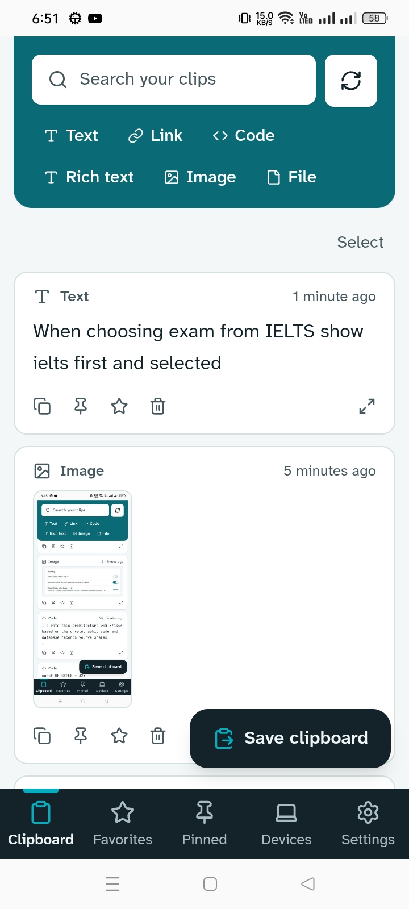
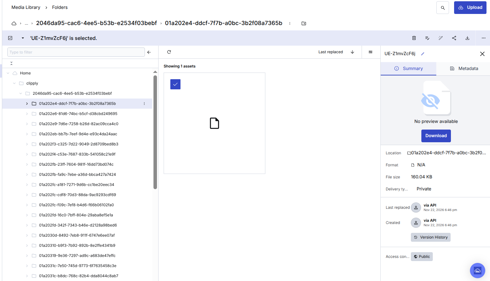
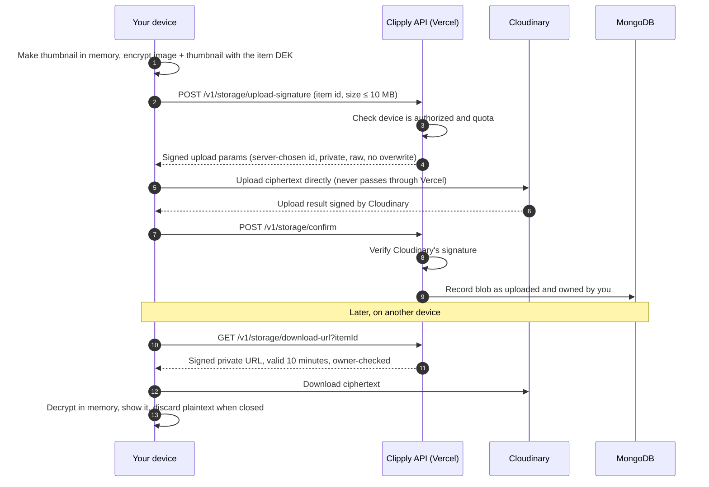

# Clipply

**End-to-end encrypted clipboard history, synced between Ubuntu and Android.**

Copy something on your laptop, find it on your phone, and the other way round: text, links, code, rich text, images and files. Everything is encrypted on your device before it leaves, so the server stores data it cannot read.

| Platform | Package | Where to get it |
|---|---|---|
| Android 7.0+ (API 24) | `Clipply-<version>.apk` | [GitHub Releases](https://github.com/Sharif-Minhaz/clipply/releases/latest) |
| Ubuntu / Debian (x64) | `clipply_<version>_amd64.deb` or `Clipply-<version>-x86_64.AppImage` | [GitHub Releases](https://github.com/Sharif-Minhaz/clipply/releases/latest) |

Current version: **0.1.2**. Clipply is not on the Play Store. The rest of this page explains what that means for your privacy, how to check that the file you downloaded is genuine, and what happens to your data at every step.

## Screenshots

<p align="center">
  
</p>
<p align="center"><em>Android: searchable history of text, links, code, rich text, images and files.</em></p>

<!-- Desktop screenshot: save it as docs/screenshots/desktop.png and uncomment.
<p align="center">
  
</p>
<p align="center"><em>Ubuntu: the same history in the desktop app.</em></p>
-->

---

## Contents

- [Privacy in one minute](#privacy-in-one-minute)
- [What the server can and cannot see](#what-the-server-can-and-cannot-see)
- [Don't take our word for it: real server data](#dont-take-our-word-for-it-real-server-data)
- [How the encryption works](#how-the-encryption-works)
- [End-to-end data flow: device → Vercel → MongoDB → Cloudinary](#end-to-end-data-flow)
- [Adding devices, the recovery key, and removing devices](#adding-devices-the-recovery-key-and-removing-devices)
- [Protection on the device itself](#protection-on-the-device-itself)
- [Android permissions, explained](#android-permissions-explained)
- [Update channel and verifying downloads](#update-channel-and-verifying-downloads)
- [Installing](#installing)
- [Known limitations](#known-limitations)
- [Run your own server](#run-your-own-server)
- [Development](#development)
- [Further documentation](#further-documentation)

---

## Privacy in one minute

Installing an app from outside the Play Store means trusting the developer instead of Google's review. Clipply is built so that you need to trust the developer, and the services it runs on, as little as possible:

- **Encrypted on your device, decrypted only on your devices.** Content is encrypted with keys that are created on your device and are never sent to the server in readable form. The server, the database (MongoDB Atlas), the file storage (Cloudinary) and the host (Vercel) only ever receive ciphertext.
- **Google sign-in identifies your account and nothing more.** Your Google account is not used to derive or unlock any key. If someone took over the Clipply server or your Google login, they still could not decrypt your history.
- **New devices need your approval.** A device you add only gets your keys after you compare a 12-digit code on both screens. The server cannot add a device on its own.
- **No analytics, no ads, no crash reporting, no third-party SDKs that phone home.** The app talks to your Clipply API, Google (only for sign-in), Cloudinary (only to upload/download encrypted image and file blobs) and, at most once a day, GitHub (only to ask whether a newer version exists — [details](#in-app-update-check)). Link previews, if you leave them on, fetch the linked page's preview image.
- **Works without an account.** Sync is optional. Without signing in, your history stays on the device, still encrypted at rest.
- **Open source.** Everything in this README can be checked in the code; file paths are given throughout.
- **Signed releases with checksums.** Every release ships a `SHA256SUMS` file, and the Android APK is always signed with the same key, so Android itself refuses any "update" signed by someone else ([details](#update-channel-and-verifying-downloads)).

If even that is not enough, you can [run your own server](#run-your-own-server): then nobody but you operates any part of the system.

---

## What the server can and cannot see

| Data | Server / MongoDB / Cloudinary | Notes |
|---|---|---|
| Clip content (text, links, code, rich text) | ❌ cannot read | Encrypted with a per-item key (XChaCha20-Poly1305) |
| Images, screenshots, files | ❌ cannot read | Encrypted on the device, uploaded to Cloudinary as an opaque private blob |
| Image thumbnails | ❌ cannot read | Made on the device, encrypted with the item's key |
| Clip type (text / link / image …), title, favorite, pinned, source device, timestamps you see in the app | ❌ cannot read | All inside the encrypted `meta` field. Filtering and search run locally |
| Your encryption keys, device private keys, recovery key | ❌ never sent | Only public keys and sealed (encrypted) keyrings reach the server |
| Exact content length | ❌ hidden | Ciphertext is padded to size buckets (256 B / 4 KiB / 64 KiB steps) |
| Your Google email address | ✅ visible | Needed to identify the account; shown on the Devices screen |
| Device names, platform, app version, last-seen / last-sync time | ✅ visible | Needed to show the device list before your vault is unlocked. You choose the names |
| Number of items, padded sizes, when you sync | ✅ visible | Unavoidable metadata of any sync service |
| Your IP address | ✅ visible | Seen by Vercel on every request. The API stores it only as part of a rate-limit counter on the sign-in endpoint, auto-deleted within ~2 minutes |

The server's job is reduced to **ordering, storing and authorizing**. It never decrypts anything. This is enforced by the design, not by a policy: the server simply never holds a key that could decrypt your data.

---

## Don't take our word for it: real server data

These are screenshots of the production MongoDB Atlas database and Cloudinary account, showing the developer's own synced history. This is what the operator sees.

### MongoDB: clipboard items


Each document is one clip. `dek`, `meta` and `body` are XChaCha20-Poly1305 ciphertext (base64url). There is no `text`, `type`, `title`, `favorite` or `pinned` field: all of that is inside `meta`, encrypted. The only readable fields are random ids, the key epoch, revision/sequence counters, a `deleted` flag and the server's own timestamp.

### MongoDB: device key envelopes


This is how your keyring travels between devices. `sealed` is the keyring encrypted to one device's public key (X25519 sealed box), so only that device can open it; `signature` is an Ed25519 signature by the device that published it (`signerDeviceId`). `epoch: 2` shows a key rotation happened after a device was removed.

### Cloudinary: images and files


Blobs are stored under `clipply/<userId>/<itemId>/`. Notice that Cloudinary shows **no thumbnails**: it has nothing it can decode.



Opening one of them (a 160 KB image clip): **"No preview available"**, **Format: N/A**, **Delivery type: Private**. To Cloudinary it is 160 KB of random bytes. Downloading it requires a signed URL that only the Clipply API issues, only to the owner, valid for 10 minutes — and even then you get the same ciphertext, useless without the keys on your devices. ("Access control: Public" in that panel is a separate Cloudinary setting for access-mode; the *private* delivery type is what blocks unsigned downloads.)

You can reproduce this yourself by [running your own server](#run-your-own-server) and looking at your own database.

---

## How the encryption works

All cryptography uses [libsodium](https://doc.libsodium.org/), a widely audited library. No custom ciphers. Implementation: [packages/crypto](packages/crypto/src); full specification: [docs/encryption.md](docs/encryption.md).

### Building blocks

| Purpose | Primitive |
|---|---|
| Encrypting content and wrapping keys | XChaCha20-Poly1305 (256-bit key, random 192-bit nonce) — authenticated encryption, any tampering is detected |
| Delivering the keyring to a device | X25519 sealed boxes (public-key encryption) |
| Signing keyrings and recovery proofs | Ed25519 signatures |
| Deriving sub-keys | BLAKE2b KDF |
| Duplicate detection without revealing content | BLAKE2b keyed hash (key derived from your vault key, unknown to the server) |
| Hiding content length | ISO/IEC 7816-4 padding to size buckets |

### Key hierarchy

```text
Recovery key (256-bit, shown to you once, 55 characters)
  └─ derives a recovery key-pair: lets you restore access if you lose every device

Keyring  (lives only on your devices, inside OS secure storage)
  ├─ vault keys  { epoch 1: VK1, epoch 2: VK2, … }   random 256-bit, a new one after each device removal
  ├─ roster      the list of your authorized devices and their public keys
  └─ recovery    public keys of your recovery key

Per item:  a fresh random 256-bit data key (DEK)
  ├─ DEK  is encrypted with the current vault key
  ├─ meta (type, title, flags, timestamps, source device)  encrypted with DEK
  ├─ body (the content itself)                              encrypted with DEK
  └─ thumb (image preview)                                  encrypted with DEK

Per device: an X25519 + Ed25519 key-pair that never leaves the device's secure storage
```

Each ciphertext is bound to its item and field (`clipply/v1/<itemId>/<field>` as associated data), so the server cannot swap one item's content into another or replace a title with a body: decryption would fail.

### What happens when you copy something

1. The app reads the clipboard **on your device** (on Android only when the app is focused, or when you share / use the tile — see [permissions](#android-permissions-explained)).
2. Password-manager clips are skipped (Android `EXTRA_IS_SENSITIVE`, Linux `x-kde-passwordManagerHint`).
3. A keyed hash checks for duplicates locally.
4. A new random DEK encrypts the content, its metadata and (for images) a thumbnail generated on the device.
5. The encrypted item is saved in the local database, which stores **the same ciphertext** the server gets.
6. If sync is on, the ciphertext is uploaded. Plaintext exists only in memory while it is being shown.

---

## End-to-end data flow

```text
 Your Ubuntu PC (Electron)                      Your Android phone (Capacitor + Kotlin)
 ┌──────────────────────────────┐               ┌──────────────────────────────┐
 │ capture → encrypt → SQLite   │               │ capture → encrypt → SQLite   │
 │ keys in libsecret keyring    │               │ keys in Android Keystore     │
 └──────────────┬───────────────┘               └──────────────┬───────────────┘
                │  HTTPS, ciphertext only                      │
                ▼                                              ▼
        ┌─────────────────────────────────────────────────────────────┐
        │ Clipply API — Express on Vercel (serverless, stateless)     │
        │ checks who you are, orders changes, signs storage requests  │
        └───────────┬─────────────────────────────────┬───────────────┘
                    ▼                                 ▼
     MongoDB Atlas                           Cloudinary
     encrypted items + minimal metadata      encrypted image/file blobs
                                             (private, raw, unreadable)
```

### Vercel (the API)

- Runs the Express API ([apps/server](apps/server/src)) as a single serverless function. It keeps no state in memory: everything lives in MongoDB.
- Every request is validated against strict schemas; errors return only a short code, never your data.
- Logs carry ids, routes and counts only. A shared logger ([packages/logger](packages/logger/src/index.ts)) redacts any field named like content, body, title, key, token, etc. before it is written — even ciphertext never reaches logs.
- Sign-in: the app sends a Google ID token; the API verifies it, then issues its own short-lived access token (15 min) and a rotating refresh token (90 days). Only a SHA-256 hash of refresh tokens is stored; replaying an old refresh token revokes the session.
- A daily cron job cleans up deleted blobs and old tombstones.

### MongoDB Atlas (the database)

What is stored, per collection:

| Collection | Contents |
|---|---|
| `users` | Google account id (`sub`), email, a change counter, current key epoch, your recovery **public** key and a copy of the keyring **sealed** to it (openable only with your recovery key) |
| `devices` | Device id, name, platform, app version, status (pending / authorized / revoked), **public** keys, timestamps |
| `device_key_envelopes` | Your keyring, **sealed** to each device's public key and signed — only that device can open it |
| `clipboard_items` | Item id, encrypted `dek` / `meta` / `body` / `thumb`, key epoch, revision, deleted flag, server timestamps |
| `encrypted_objects` | Which Cloudinary blob belongs to which item, its size and upload state |
| `sessions` | SHA-256 hashes of refresh tokens |
| `sync_events`, `rate_limits` | Idempotency records (7-day TTL) and rate-limit counters (minutes) |

A full dump of this database gives an attacker email addresses, device names and encrypted blobs — not one byte of clipboard content.

### Cloudinary (images and files)

Images and files are too big for the database, so their **encrypted** bytes go to Cloudinary. Plaintext images never touch Cloudinary, the API or the database.



- Blobs are stored as `type=private`, `resource_type=raw`: Cloudinary cannot render, resize or index them (they are random bytes to it), and they cannot be fetched without a signed, short-lived URL that only the API can issue — and only to the owner.
- Blob ids are chosen by the server (`clipply/<userId>/<itemId>/<random>`) and cannot be overwritten, so one user can never replace another's file.
- When you delete an item, its blob is destroyed on Cloudinary by the daily cleanup.
- Implementation: [apps/server/src/modules/storage](apps/server/src/modules/storage).

### Sync

Every change is a small encrypted record. The server assigns each accepted change a sequence number so all devices agree on the order; devices pull "everything after number N". Conflicting edits are never silently lost: if two devices edit the same item, the losing edit is kept as an "edited copy". Deletes always win. Details: [docs/synchronization.md](docs/synchronization.md).

---

## Adding devices, the recovery key, and removing devices

### First device

When you first sign in, your device creates the vault: the keyring, your device key-pair and a **recovery key** (55 characters, shown once). Write it down or store it in a password manager. Clipply cannot show it to you again and cannot reset it for you.

### Adding another device (12-digit code)

1. Sign in on the new device. It is **pending**: the server refuses it any access to your items.
2. On an already authorized device, approve it.
3. Both devices show a 12-digit code computed from both devices' public keys. **Compare them.** If the server (or anyone in the middle) substituted a key, the codes will not match.
4. The authorized device encrypts the keyring to the new device's public key, signs it and uploads that envelope. The new device accepts it only if it is signed by the exact key whose code you confirmed.

### Lost all your devices?

Use the recovery key on a new device. It proves possession of the recovery key with a signature (the key itself is never sent), then opens a copy of your keyring that was sealed to the recovery key. If you lose **every device and the recovery key**, your history cannot be decrypted by anyone, including the developer. That is the price of real end-to-end encryption.

### Removing a device (shown in the Devices screen)

Removing a device takes effect immediately on the server (its sessions and keyring copy are deleted, it gets "forbidden" on every request). Your remaining device also **rotates the vault key**: everything saved afterwards uses a new key the removed device never had. If the removed device ever held the recovery key, a new recovery key is generated and shown to you.

You can also replace a lost or exposed recovery key at any time from an authorized device.

---

## Protection on the device itself

| | Android | Ubuntu |
|---|---|---|
| Where keys live | AES-256-GCM key inside the **Android Keystore** (non-exportable) wraps the keyring, device keys and session | Electron `safeStorage` → **GNOME Keyring / libsecret**. If no keyring is available, Clipply refuses to store keys rather than storing them in clear |
| Local database | Same ciphertext as the server; no plaintext index on disk | Same; file created with `0600` permissions |
| Backups | `allowBackup="false"`, cloud backup and device transfer excluded — your keys never land in a Google backup | — |
| Things captured while the app is closed | Encrypted immediately with a Keystore key into a private inbox; verified with a plaintext search over the files (0 hits) | Capture runs in the background tray app |
| Images | Shown from memory; copying an image to the clipboard is served from memory through a content provider — no plaintext file is written | Shown via in-memory `blob:` URLs |
| Logs | Plugin bridge logging disabled; app logs redacted | Redacted logs in `~/.config/Clipply/logs/main.log` (`0600`, rotated at 2 MB) |
| Password-manager clips | Skipped | Skipped |

Search works by decrypting your history into memory after unlock; nothing decrypted is ever written to disk.

---

## Android permissions, explained

Clipply asks for very little. From [AndroidManifest.xml](apps/mobile/android/app/src/main/AndroidManifest.xml):

| Permission | Why |
|---|---|
| `INTERNET` | Sync with your Clipply API, Google sign-in, encrypted blob upload/download |
| `READ_MEDIA_IMAGES` (Android 13+) / `READ_EXTERNAL_STORAGE` (Android ≤ 12) | **Only** requested if you turn on "Import new screenshots". Only files in the `Screenshots` folder created after you enable it are imported |

That is all. No contacts, location, microphone, camera, phone, SMS, accessibility service, notification listener, or "display over other apps".

How capture works without background clipboard spying (Android 10+ forbids it, and Clipply does not try to bypass it):

- **Open the app** → the current clipboard is read once (you can turn this off).
- **Share** text, images or files to Clipply from any app.
- **Select text → "Save to Clipply"** in the selection menu.
- **Quick Settings tile** "Save clipboard".
- **Screenshots** (opt-in) → Android wakes Clipply only when a new image appears.

No foreground service, no polling, no wake locks, no always-open connection. Measured on the emulator: 0 alarms, 0 wake locks and no network for the app while idle in the background.

---

## Update channel and verifying downloads

**GitHub Releases is the only official distribution channel:** <https://github.com/Sharif-Minhaz/clipply/releases>. There is no Play Store listing, no mirror, no third-party APK site. A Clipply download from anywhere else is not from this project.

### How releases are produced

Releases are built by [scripts/release.mjs](scripts/release.mjs) (`npm run publish`):

1. Bump the version in every app (Android `versionCode` always increases, so Android refuses a downgrade).
2. Build the Linux packages and the signed Android APK. The build refuses to run if the APK would be unsigned or if the app points at a development server.
3. Commit the version, create the git tag `v<version>`, push.
4. Upload all files to a **draft** GitHub release, generate `SHA256SUMS` for every file, and only then publish — so nobody ever downloads a half-uploaded release.

Each release contains:

| File | Purpose |
|---|---|
| `Clipply-<version>.apk` | Android app, signed with the release key |
| `clipply_<version>_amd64.deb` | Ubuntu / Debian package |
| `Clipply-<version>-x86_64.AppImage` | Portable Linux app |
| `latest-linux.yml` | Update metadata for the desktop app |
| `SHA256SUMS` | SHA-256 checksum of every file above |

### Check the checksum

```sh
# in the folder with the downloaded files
sha256sum -c SHA256SUMS --ignore-missing
```

On Android you can compare the APK's SHA-256 with a file-manager "checksum" feature or any hash app.

### Check the APK signing certificate

Every Clipply APK is signed with the same certificate:

```text
SHA-256: a8:5d:b1:c3:d5:10:77:d2:0c:3c:c7:75:b2:a1:94:2d:87:de:f0:fa:1a:d3:97:9e:92:8c:8f:87:e9:ba:12:93
```

Verify it before installing:

```sh
apksigner verify --print-certs Clipply-<version>.apk
# Signer #1 certificate SHA-256 digest: a85db1c3d51077d20c3cc775b2a1942d87def0fa1ad3979e928c8f87e9ba1293
```

**Why this matters for updates:** Android only installs an update over an existing app if it is signed with the **same key**. Once you have a genuine Clipply installed, a tampered APK from someone else cannot replace it — Android shows "App not installed" instead. Your keys stay inside the Keystore of the genuine app.

### How to update

- **Android:** download the new APK from Releases and open it; Android installs it over the current version and keeps your data.
- **Ubuntu (.deb):** `sudo apt install ./clipply_<version>_amd64.deb`.
- **Ubuntu (AppImage):** replace the old file with the new one.

### In-app update check

Both apps can tell you when a new version is out: **Settings → Updates** shows your version and a **Check for updates** button. When a newer release exists, the desktop sidebar shows "Update available" and the Android Clipboard tab shows a banner. Tapping it opens the release page in your browser; you download and install the update yourself, exactly as above.

What it does, and what it does not do:

- **One anonymous request** to GitHub's public API: `GET https://api.github.com/repos/Sharif-Minhaz/clipply/releases/latest`. No account, device id, token or anything about your clips is sent. GitHub sees your IP address, as with any website.
- **At most once a day**, when the app opens (Android) or its window gets focus (desktop). Nothing is polled in the background. Pressing "Check for updates" always checks.
- **Check only.** Clipply never downloads or installs anything by itself, and the Android app does not have the "install other apps" permission.
- **The link cannot be redirected.** The app reads only the version number from GitHub's answer and builds the link to `github.com/Sharif-Minhaz/clipply/releases/tag/v<version>` itself; drafts and pre-releases are ignored.
- **You can turn it off:** Settings → Updates → "Check for updates automatically". The manual button keeps working.

Implementation: [packages/sync-engine/src/update.ts](packages/sync-engine/src/update.ts).

---

## Installing

### Android

1. Download `Clipply-<version>.apk` from [Releases](https://github.com/Sharif-Minhaz/clipply/releases/latest) and optionally [verify it](#update-channel-and-verifying-downloads).
2. Open it. Android asks once to allow installs from your browser / file manager ("Install unknown apps"). You can switch that permission off again after installing.
3. If Play Protect shows "unknown developer", this is because the app is not on the Play Store, not because something was detected. Choose "Install anyway".
4. Open Clipply. Use it locally, or sign in with Google to sync. On your first device, **save the recovery key**.
5. Optional: add the "Save clipboard" tile to Quick Settings.

### Ubuntu

```sh
sudo apt install ./clipply_<version>_amd64.deb
# or
chmod +x Clipply-<version>-x86_64.AppImage && ./Clipply-<version>-x86_64.AppImage
```

The app keeps running in the tray when you close the window. On GNOME Wayland, press "Add shortcut" in Settings to register `Super+V` as a GNOME custom shortcut that shows/hides Clipply (GNOME's notification list moves to `Super+M`). Tested on Ubuntu 24.04 / GNOME 46.

To add the phone as a second device: sign in on it, approve it from the computer, and compare the 12-digit code on both screens.

---

## Known limitations

Being honest about these is part of being trustworthy:

- **A compromised, unlocked device** (malware running as you) can read what you can read. No app can prevent that.
- **Metadata** listed in [the table above](#what-the-server-can-and-cannot-see) — email, device names, item counts, padded sizes, timing, IP addresses — is visible to the server and its hosting providers.
- **The server can withhold or replay** an older version of an item. It cannot read or forge content, but it can refuse to deliver changes.
- **A device you removed, colluding with the server,** could briefly target a device that has not synced since the removal. Devices refresh on every sync, so the window is small.
- **Backups** (export/import) are protected by your passphrase with PBKDF2 (600 000 iterations). A weak passphrase is the weak point; use 4+ random words.
- Android keeps keys in WebView memory while the app is open; new items from other devices appear when you open the app (no push notifications, by design).
- Android background capture uploads **text** immediately; images captured while the app is closed upload the next time you open it.
- Linux on GNOME Wayland: copies from native Wayland apps cannot be attributed to an app, so the "excluded apps" setting only works for X11/XWayland windows.
- Updates are not installed automatically: the app tells you, you download the new version from GitHub Releases.

The full threat model, with which protections are covered by automated tests: [docs/encryption.md §8](docs/encryption.md#8-threat-model).

---

## Run your own server

The official apps point at the project's API. For maximum control you can deploy your own on free tiers (no credit card): Vercel Hobby, MongoDB Atlas M0, Cloudinary Free and a Google OAuth client. Then build the apps with your API URL. Step-by-step: [docs/deployment.md](docs/deployment.md).

Even then, nothing changes about the encryption: your own server still only ever sees ciphertext.

---

## Development

### Layout

```text
apps/
  desktop/   Electron 45 + React 19: clipboard capture, tray, shortcuts, safeStorage
  mobile/    Capacitor 8 + React 19 + Kotlin: capture entry points, Keystore, WorkManager
  server/    Express 5 on Vercel: auth, devices, vault, sync, storage, daily cleanup
packages/
  shared-schemas  Zod schemas for every wire format (single source of truth)
  crypto          libsodium: item encryption, keyring, envelopes, recovery, backups
  sync-engine     capture → dedupe → encrypt → store → push/pull, vault protocol
  database        SQLite migrations and repositories
  api-client      typed HTTP client
  ui              shared React UI for both apps
  logger          logger with recursive redaction of content and secrets
docs/             architecture · encryption · synchronization · backend · desktop · android · deployment
scripts/          release pipeline
```

The Android background path re-implements only item encryption in Kotlin (Tink + BouncyCastle) and is pinned to the TypeScript output by shared test vectors ([packages/crypto/vectors/item-v1.json](packages/crypto/vectors/item-v1.json)).

### Setup

Requires Node ≥ 24 (npm workspaces). Android builds need JDK 21+ and the Android SDK.

```sh
npm install
npm run gate               # typecheck + tests in every package
```

Each app reads its configuration from a `.env` file; copy the `.env.example` next to it: [apps/server](apps/server/.env.example), [apps/desktop](apps/desktop/.env.example), [apps/mobile](apps/mobile/.env.example).

### Build and run (from the repo root)

| Script | What it does |
|---|---|
| `npm run desktop:dev` | Desktop app with hot reload |
| `npm run desktop:dist` | AppImage + deb in `apps/desktop/dist/` (`dist:dir` in the workspace: unpacked, faster) |
| `npm run server:dev` / `server:build` | Local API / Vercel bundle |
| `npm run android:debug` | Debug APK |
| `npm run android:install:usb` / `android:install:wifi` | Install the debug APK on a phone (Wi-Fi: wireless debugging, optional pairing) |
| `npm run android:live` / `android:live:wifi` | Run on the phone with live reload (served as `http://localhost` via `adb reverse`, so WebCrypto works) |
| `npm run android:logs` | WebView console, Kotlin plugin/worker logs, WorkManager, crashes |
| `npm run android:release` | Release APK, signed when `apps/mobile/android/keystore.properties` exists, otherwise unsigned |
| `npm run icons:android -w @clipply/mobile` | Regenerate launcher icons from `apps/mobile/assets/` |

### Releasing

| Script | What it does |
|---|---|
| `npm run publish [-- patch\|minor\|major\|x.y.z]` | Everything below, in order (default `patch`) |
| `npm run release:bump` | Bump desktop, mobile and Android `versionCode`/`versionName` |
| `npm run release:build` / `:linux` / `:android` | Build and stage artifacts in `release/v<version>/` (Linux and Android in parallel) |
| `npm run release:tag` | Commit the version files and create tag `v<version>` |
| `npm run release:push` | Push the branch and the tag |
| `npm run release:upload` | Create/complete the GitHub release, write `SHA256SUMS`, publish |

Each step after `bump` can be re-run on its own if one fails. The GitHub token comes from `GH_TOKEN` / `GITHUB_TOKEN` or `GH_TOKEN=…` in `.env.release` (gitignored; needs "Contents: read & write"). Build steps run without the token, so electron-builder can never publish by itself.

Release signing — create once, keep both files out of git (already ignored) and backed up:

```sh
keytool -genkeypair -v -keystore apps/mobile/android/clipply-release.jks -alias clipply -keyalg RSA -keysize 4096 -validity 10000
cat > apps/mobile/android/keystore.properties <<'P'
storeFile=clipply-release.jks
storePassword=…
keyAlias=clipply
keyPassword=…
P
```

Losing the keystore means users must uninstall to update, and the published certificate fingerprint above would change. Register the release key's SHA-1 (`keytool -list -v -keystore …`) as an Android OAuth client too.

---

## Further documentation

- [Architecture](docs/architecture.md) — components, decisions, data model, risks
- [Encryption](docs/encryption.md) — key hierarchy, ciphertext format, enrollment, recovery, rotation, threat model
- [Synchronization](docs/synchronization.md) — ordering, conflicts, loop prevention
- [Backend](docs/backend.md) — API, collections, limits, maintenance
- [Deployment](docs/deployment.md) — MongoDB Atlas, Cloudinary, Google OAuth, Vercel
- [Desktop](docs/desktop.md) — GNOME Wayland/X11 clipboard, screenshots, tray, shortcuts
- [Android](docs/android.md) — clipboard limits, capture entry points, battery rules
- [Roadmap](docs/development-roadmap.md)
