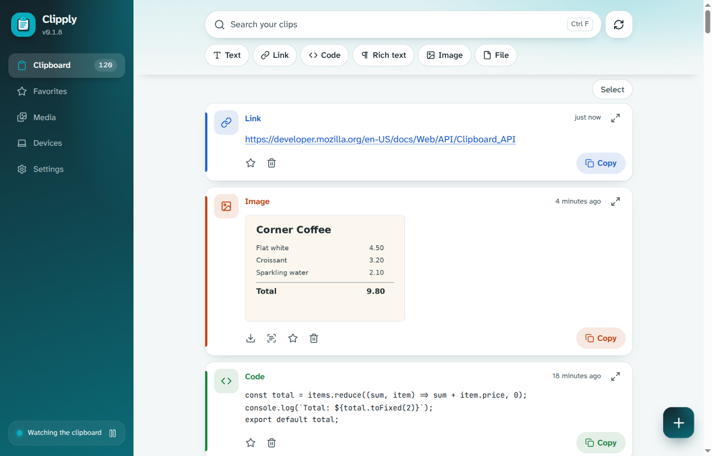
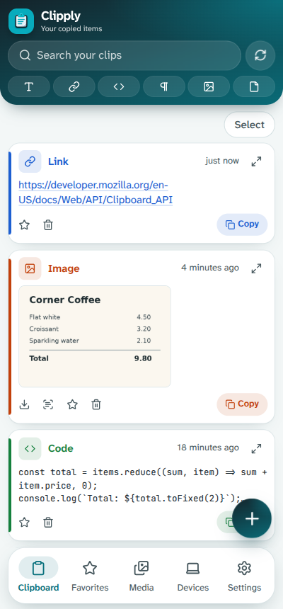
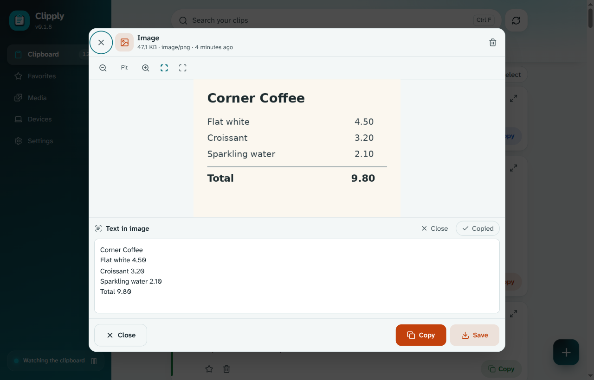
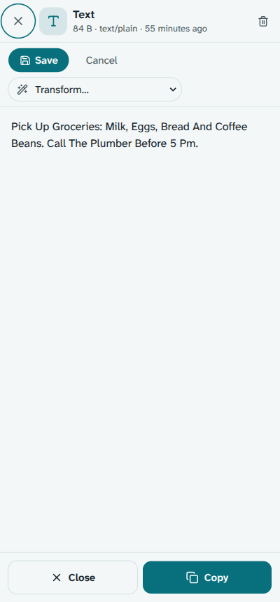
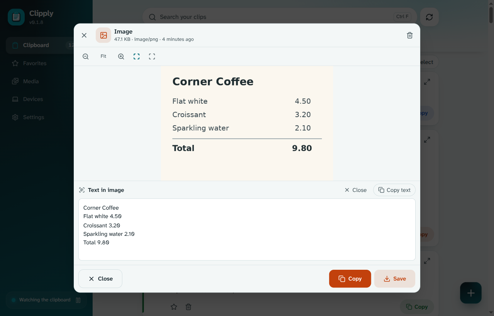
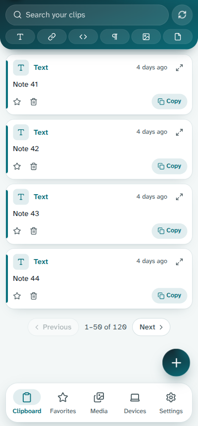
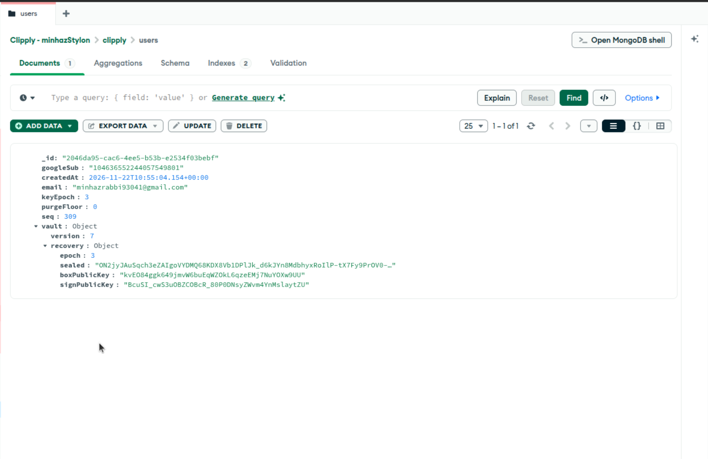
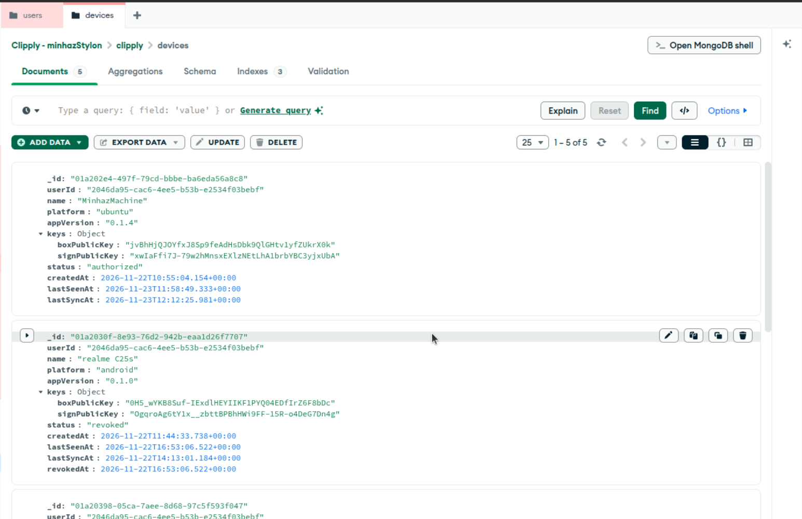

# Clipply

**End-to-end encrypted clipboard history, synced between Ubuntu and Android.**

Copy text, links, code, rich text, images or files on one device and find them on the other. Content is encrypted on the device before it leaves, so the server (Express on Vercel, MongoDB Atlas, Cloudinary) only stores ciphertext. Sync is optional: without an account, history stays on the device, still encrypted at rest.

| Platform | Package | Where to get it |
|---|---|---|
| Android 7.0+ (API 24) | `Clipply-<version>.apk` | [GitHub Releases](https://github.com/Sharif-Minhaz/clipply/releases/latest) |
| Ubuntu / Debian (x64) | `clipply_<version>_amd64.deb` or `Clipply-<version>-x86_64.AppImage` | [GitHub Releases](https://github.com/Sharif-Minhaz/clipply/releases/latest) |

Clipply is not on the Play Store. GitHub Releases is the only official channel. Code walkthrough: [docs/code-overview.md](docs/code-overview.md).

## Screenshots

Both apps share one UI (`packages/ui`). Screenshots use demo data.

| Ubuntu (desktop) | Android |
|---|---|
|  |  |
| The global shortcut opens the window ready to type. Ctrl+F or `/` focuses search, the arrow keys move between clips, and Enter copies and hides the window so you can paste | Capture on app open, share sheet, text selection, Quick Settings tile and screenshots |
|  |  |
| **Copy text** in the viewer, or the scan button on an image card, recognizes the text on the device (OCR, never automatic). English and Bengali are on; Arabic, Hindi and Japanese can be added in Settings | Transform text before saving: trim, join lines, change case, format or minify JSON, remove link tracking |
|  |  |
| The text is copied, stored encrypted with the clip (so search finds it), and opens in an editable box: fix it and copy again | History is paged: 100 clips per page on desktop, 50 on Android, and only the current page is loaded into the UI |

In selection mode, **Copy as text** joins the selected text clips (in the order you picked them) into one clipboard entry. Files open inside Clipply (PDF, images, audio, video, CSV, text), rich text is shown formatted, and **Settings → Similar clips** finds near-duplicate texts and images.

---

## Contents

- [Privacy and what the server sees](#privacy-and-what-the-server-sees)
- [Architecture](#architecture)
- [Encryption](#encryption)
- [Don't take our word for it: real server data](#dont-take-our-word-for-it-real-server-data)
- [Devices, recovery key and removal](#devices-recovery-key-and-removal)
- [Protection on the device](#protection-on-the-device)
- [Android permissions](#android-permissions)
- [Install and verify](#install-and-verify)
- [Known limitations](#known-limitations)
- [Run your own server](#run-your-own-server)
- [Development](#development)
- [Further documentation](#further-documentation)

---

## Privacy and what the server sees

- Keys are created on your devices and never reach the server in readable form. The API, MongoDB Atlas, Cloudinary and Vercel only receive ciphertext.
- Google sign-in identifies the account only; it does not derive or unlock any key. Taking over the server or your Google login does not decrypt your history.
- A new device gets your keys only after you pair it with an existing one (QR code, or a 12-digit code between two computers). The server cannot add a device by itself.
- No analytics, ads, crash reporting or third-party SDKs. Network traffic goes to your Clipply API, Google (sign-in), Cloudinary (encrypted blobs), GitHub (update check, see [below](#in-app-update-check)) and, if link previews are on, the linked page's preview image.

| Data | Server can read? | Notes |
|---|---|---|
| Clip content, images, files, thumbnails | No | Per-item key, XChaCha20-Poly1305; blobs go to Cloudinary as opaque private files |
| Type, title, favorite, pinned, text recognized in images, source device, timestamps | No | Inside the encrypted `meta` field; filtering and search run locally |
| Vault keys, device private keys, recovery key | Never sent | Only public keys and sealed keyrings reach the server |
| Exact content length | No | Padded to size buckets (256 B / 4 KiB / 64 KiB steps) |
| Google email, device names, platform, app version, last-seen time | Yes | Needed for the account and the Devices screen before unlock |
| Item count, padded sizes, sync timing | Yes | Unavoidable for any sync service |
| IP address | Yes | Seen by Vercel; the API keeps it only in a sign-in rate-limit counter, deleted within ~2 minutes |

The server orders, stores and authorizes. It never holds a key that could decrypt your data.

---

## Architecture

```text
 Ubuntu PC — Electron (apps/desktop)                Android phone — Capacitor + Kotlin (apps/mobile)
 ┌───────────────────────────────────────┐          ┌───────────────────────────────────────┐
 │ renderer: shared React UI (packages/ui)│          │ WebView: shared React UI (packages/ui) │
 │        ▲ IPC (fixed channels, Zod)     │          │  + sync-engine + crypto (TypeScript)   │
 │ main process:                          │          │  + SQLite (capacitor-sqlite)           │
 │  clipboard helper (XWayland) ─┐        │          ├───────────────────────────────────────┤
 │  screenshot watcher ──────────┤        │          │ Kotlin (runs without the WebView):     │
 │  sync-engine + crypto (TS) ◄──┘        │          │  share / tile / text-select / screenshot│
 │  SQLite (node:sqlite)                  │          │  → encrypt → Keystore inbox → WorkManager│
 │  keys: safeStorage → GNOME Keyring     │          │  keys: Android Keystore                │
 └──────────────────┬────────────────────┘          └──────────────────┬────────────────────┘
                    │        HTTPS · JSON · ciphertext only            │
                    └──────────────────────┬───────────────────────────┘
                                           ▼
                    ┌─────────────────────────────────────────────────┐
                    │ Clipply API — Express 5 on Vercel (apps/server)  │
                    │ stateless · auth · devices · vault · sync ·      │
                    │ storage signatures · daily cleanup cron          │
                    └──────────┬──────────────────────────┬───────────┘
                               ▼                          ▼
                    MongoDB Atlas                Cloudinary (private, raw)
                    encrypted items, sealed      encrypted image / file blobs (> ~48 KB),
                    keyrings, minimal metadata   uploaded/downloaded directly by devices
```

Both apps run the same TypeScript core (`packages/sync-engine`, `crypto`, `database`, `ui`); each platform supplies only clipboard access, secure key storage and the UI shell. Sync is offline-first: local SQLite holds the same ciphertext as the server and is the source of truth, changes go through an outbox, the server numbers each accepted change (`seq`) and devices pull everything after their cursor. Details: [docs/architecture.md](docs/architecture.md), [docs/synchronization.md](docs/synchronization.md).

---

## Encryption

All cryptography is [libsodium](https://doc.libsodium.org/); no custom ciphers. Code: [packages/crypto](packages/crypto/src). Full specification and threat model: [docs/encryption.md](docs/encryption.md).

- **Content and key wrapping:** XChaCha20-Poly1305 (256-bit key, random 192-bit nonce).
- **Keyring delivery to a device:** X25519 sealed boxes. **Signatures** on keyrings and recovery proofs: Ed25519.
- **Sub-keys:** BLAKE2b KDF. **Duplicate detection:** BLAKE2b keyed hash with a key derived from the vault key.
- **Length hiding:** ISO/IEC 7816-4 padding to size buckets.

Key hierarchy:

- **Device key-pair** (X25519 + Ed25519): created on each device, never leaves its secure storage.
- **Keyring** (only on your devices): vault keys per epoch (random 256-bit, a new one after each device removal), the roster of authorized devices and their public keys, and the recovery public keys.
- **Per item:** a fresh random 256-bit DEK encrypts `meta`, `body`, `thumb` and recognized text (`ocr`); files over 10 MB (up to 100 MB) are encrypted and uploaded in 4 MB chunks; the DEK is stored encrypted with the current vault key. Each ciphertext is bound to `clipply/v1/<itemId>/<field>` as associated data, so the server cannot swap fields or items.
- **Recovery key** (256-bit, 55 characters, shown once): derives a key-pair that opens a server-held copy of the keyring sealed to it.

Flow: the copying device encrypts locally, writes the ciphertext and an outbox row in one SQLite transaction, then pushes. Images and files upload directly to Cloudinary with an API-issued signature. Other devices pull, unwrap the DEK with the vault key of the item's `keyEpoch`, and decrypt `meta` and text into an in-memory index. Blobs are fetched on demand via a 10-minute signed URL and decrypted in memory; plaintext is never written to disk.

In short: private keys never move. The vault key travels only inside an envelope sealed to one device's public key and signed by the device it paired with.

---

## Don't take our word for it: real server data

Screenshots of the production MongoDB Atlas database and Cloudinary account (the developer's own history), i.e. what the operator sees.

- **`clipboard_items`:** `dek`, `meta` and `body` are ciphertext; only ids, key epoch, rev/seq counters, a `deleted` flag and server timestamps are readable.
  
- **`device_key_envelopes`:** keyrings sealed to one device each, with an Ed25519 signature and `signerDeviceId`; `epoch: 2` shows a rotation after a device removal. Earlier envelopes live in `device_key_envelope_history` (365 days).
  
- **`users`:** `googleSub`, email, `seq` counter, `keyEpoch`, and `vault.recovery` (recovery public keys plus the keyring sealed to them).
  
- **`devices`:** name, platform, app version, status (`pending` / `authorized` / `revoked`) and public keys only; revoked records are deleted after 30 days.
  
- **`encrypted_objects`:** which Cloudinary blob belongs to which item, padded size and lifecycle state; no content or file names.
  
- **`sessions`:** refresh tokens stored only as SHA-256 hashes; `previousHash` detects replay of a rotated token.
  
- **`sync_events`:** push results keyed by `opId` so retries are idempotent; deleted after 7 days. (`rate_limits` is the only other collection.)
  
- **Cloudinary folders:** `clipply/<userId>/<itemId>/`, no thumbnails because nothing is decodable.
  
- **Cloudinary asset:** "No preview available", Format N/A, Delivery type Private; downloads need a 10-minute signed URL from the API.
  

A full dump yields emails, device names and encrypted blobs, not clipboard content.

---

## Devices, recovery key and removal

- **First device:** signing in creates the vault, the device key-pair and a **recovery key** (shown once). Save it; it cannot be shown again or reset.
- **Adding a device:** sign in with the same Google account; the new device stays `pending` with no access to items, and your other devices show "*Device* wants to join your account". Pair by QR code (either device shows it, the phone scans: **Devices → Scan its QR code** or **Devices → Show this device's QR code**). The code carries a fingerprint of the showing device's public keys and a one-time secret valid 10 minutes that never passes through the server. Two computers without a camera: tap **Approve** and compare the 12-digit code on both screens. The approving device then seals the keyring to the new device and signs it.
- **Lost every device:** enter the recovery key on a new device. It proves possession with a signature (the key is never sent) and opens the recovery copy of the keyring. Losing all devices and the recovery key means nobody, including the developer, can decrypt the history.
- **Removing a device:** its sessions and keyring copy are revoked immediately. A remaining device rotates the vault key, so later items use a key the removed device never had; if it ever held the recovery key, a new one is generated. You can also replace the recovery key at any time.
- **Signing out** deletes this device's keys and local history only; the server copy is untouched.

Protocol details: [docs/encryption.md §5](docs/encryption.md#5-protocols).

---

## Protection on the device

- **Keys:** Android wraps the keyring, device keys and session with a non-exportable AES-256-GCM key in the Android Keystore. Ubuntu uses Electron `safeStorage` (GNOME Keyring / libsecret) and refuses to store keys if no keyring is available.
- **Local database:** the same ciphertext as the server; no plaintext index on disk (desktop file is `0600`). Search decrypts into memory after unlock.
- **Images:** shown and copied from memory (`blob:` URLs, Android content provider); no plaintext file is written.
- **Android backups:** `allowBackup="false"`, cloud backup and device transfer excluded.
- **Logs:** content and secrets redacted; desktop log at `~/.config/Clipply/logs/main.log` (`0600`, rotated at 2 MB).
- **Password-manager clips** are skipped (Android `EXTRA_IS_SENSITIVE`, Linux `x-kde-passwordManagerHint`).

---

## Android permissions

From [AndroidManifest.xml](apps/mobile/android/app/src/main/AndroidManifest.xml):

| Permission | Why |
|---|---|
| `INTERNET` | Sync, Google sign-in, encrypted blob upload/download |
| `READ_MEDIA_IMAGES` (13+) / `READ_EXTERNAL_STORAGE` (12 and below) | Only if you enable "Import new screenshots"; only new files in `Screenshots` |
| `REQUEST_INSTALL_PACKAGES` | Only to open the installer for Clipply's own APK when you tap **Update** |

QR scanning uses Google Play services' code scanner, so no camera permission is needed. Android 10+ blocks background clipboard reads and Clipply does not bypass it: capture happens on app open (optional), share sheet, text selection "Save to Clipply", the Quick Settings tile, and opt-in screenshot import. No foreground service, polling or wake locks. Details: [docs/android.md](docs/android.md).

---

## Install and verify

Each [release](https://github.com/Sharif-Minhaz/clipply/releases) contains `Clipply-<version>.apk`, `clipply_<version>_amd64.deb`, `Clipply-<version>-x86_64.AppImage`, `latest-linux.yml` (desktop update metadata) and `SHA256SUMS`.

**Verify:**

```sh
sha256sum -c SHA256SUMS --ignore-missing                              # checksums
gh attestation verify Clipply-<version>.apk --repo Sharif-Minhaz/clipply  # CI-built releases only
apksigner verify --print-certs Clipply-<version>.apk
# Signer #1 certificate SHA-256 digest: a85db1c3d51077d20c3cc775b2a1942d87def0fa1ad3979e928c8f87e9ba1293
```

Every APK is signed with that certificate, and Android installs an update only if it is signed with the same key. Releases built locally (fallback path) have no attestation; use the checksum and certificate.

**Android:** open the APK, allow "Install unknown apps" for your browser or file manager, and choose "Install anyway" if Play Protect warns about an unknown developer (it is not on the Play Store). Sign in to sync or use it locally. Optionally add the "Save clipboard" Quick Settings tile.

**Ubuntu** (tested on 24.04 / GNOME 46):

```sh
sudo apt install ./clipply_<version>_amd64.deb
# or
chmod +x Clipply-<version>-x86_64.AppImage && ./Clipply-<version>-x86_64.AppImage
```

The app stays in the tray when the window is closed. On GNOME Wayland, **Settings → Add shortcut** registers `Super+V` to show/hide Clipply (GNOME's notification list moves to `Super+M`).

### In-app update check

On start, then at most once a day on focus, each app sends one anonymous `GET https://github.com/Sharif-Minhaz/clipply/releases/latest` and reads only the version from the redirect; drafts and pre-releases are ignored, and the release link is built from the version, not taken from the response. Nothing downloads until you tap **Update**: the AppImage and deb are checked against the SHA-512 in `latest-linux.yml` (deb installs via `dpkg` and asks for your admin password); Android opens the system installer. Turn off automatic checks in **Settings → Updates**. Code: [update.ts](packages/sync-engine/src/update.ts), [updater.ts](apps/desktop/electron/main/updater.ts), `installUpdate` in [ClipplyNativePlugin.kt](apps/mobile/android/app/src/main/java/co/lazycoders/clipply/ClipplyNativePlugin.kt).

---

## Known limitations

- Malware running as you on an unlocked device can read what you can read.
- The metadata in [the table above](#privacy-and-what-the-server-sees) is visible to the server and its hosts.
- The server can withhold changes or replay an older item version; it cannot read or forge content.
- A removed device colluding with the server could briefly target a device that has not synced since the removal.
- A pairing QR code seen by someone else is as sensitive as the 12-digit code; it expires after 10 minutes and is single-use.
- Backups (export/import) use PBKDF2-SHA256 with 600,000 iterations; a weak passphrase is the weak point. Files over 10 MB are not included.
- Files over 10 MB need a server of at least this version and reach other devices only on this app version or newer; older apps list them but cannot open them.
- Android: no push notifications; new items appear when you open the app. Text, images and files up to 10 MB captured while the app is closed upload in the background; larger files and very large photos (over 24 megapixels) upload when you open it.
- GNOME Wayland: copies from native Wayland apps cannot be attributed, so "excluded apps" works only for X11/XWayland windows.

Full threat model: [docs/encryption.md §8](docs/encryption.md#8-threat-model).

---

## Run your own server

Deploy the API on free tiers (Vercel Hobby, MongoDB Atlas M0, Cloudinary Free, a Google OAuth client) and build the apps with your API URL: [docs/deployment.md](docs/deployment.md).

---

## Development

```text
apps/
  desktop/   Electron 45 + React 19: clipboard capture, tray, shortcuts, safeStorage
  mobile/    Capacitor 8 + React 19 + Kotlin: capture entry points, Keystore, WorkManager
  server/    Express 5 on Vercel: auth, devices, vault, sync, storage, daily cleanup
packages/
  shared-schemas  Zod schemas for every wire format
  crypto          libsodium: item encryption, keyring, envelopes, recovery, backups
  sync-engine     capture, dedupe, encrypt, store, push/pull, vault protocol
  database        SQLite migrations and repositories
  api-client      typed HTTP client
  ui              shared React UI for both apps
  logger          logger with recursive redaction of content and secrets
scripts/          release pipeline (release.mjs)
```

Requires Node 24+ (npm workspaces); Android builds need JDK 21+ and the Android SDK. Each app reads a `.env`; copy the `.env.example` in [apps/server](apps/server/.env.example), [apps/desktop](apps/desktop/.env.example) and [apps/mobile](apps/mobile/.env.example).

```sh
npm install
npm run gate                 # typecheck + tests in every workspace
npm run desktop:dev          # desktop with hot reload
npm run desktop:dist         # AppImage + deb in apps/desktop/dist/
npm run server:dev           # local API (server:build for the Vercel bundle)
npm run android:debug        # debug APK (android:install:usb / android:install:wifi to install)
npm run android:live         # live reload on the phone via adb reverse (android:live:wifi too)
npm run android:logs         # WebView console, Kotlin and WorkManager logs
npm run android:release      # release APK, signed when apps/mobile/android/keystore.properties exists
npm run icons:android -w @clipply/mobile   # regenerate launcher icons from apps/mobile/assets/
```

On Ubuntu 24.04+ (AppArmor restricts unprivileged user namespaces), `desktop:dev` aborts with "The SUID sandbox helper binary was found, but is not configured correctly". The `.deb` installs an AppArmor profile for `/opt/Clipply/clipply` only; give the development Electron binary the same profile once (repeat if the repo moves):

```sh
E="$PWD/node_modules/electron/dist/electron"
printf 'abi <abi/4.0>,\ninclude <tunables/global>\nprofile clipply-dev "%s" flags=(unconfined) {\n  userns,\n}\n' "$E" | sudo tee /etc/apparmor.d/clipply-dev
sudo apparmor_parser -r /etc/apparmor.d/clipply-dev
```

### Releasing

`npm run publish:ci [-- patch|minor|major|x.y.z]` bumps, tags, pushes and starts the GitHub Actions release; `npm run publish` runs the same steps but builds and uploads from your machine (fallback). Individual steps: `release:bump`, `release:build[:linux|:android]`, `release:tag`, `release:push`, `release:dispatch`, `release:upload`. Setup, secrets and recovery from failed runs: [docs/release.md](docs/release.md).

Release signing key (create once, keep both files out of git and backed up offline):

```sh
keytool -genkeypair -v -keystore apps/mobile/android/clipply-release.jks -alias clipply -keyalg RSA -keysize 4096 -validity 10000
cat > apps/mobile/android/keystore.properties <<'P'
storeFile=clipply-release.jks
storePassword=…
keyAlias=clipply
keyPassword=…
P
```

Losing the keystore forces users to uninstall to update and changes the published certificate fingerprint. Also register the key's SHA-1 (`keytool -list -v -keystore …`) as an Android OAuth client.

---

## Further documentation

- [Code overview](docs/code-overview.md): how desktop, mobile and server are wired
- [Architecture](docs/architecture.md): decisions, data model, risks (its better-sqlite3 mentions are stale; the desktop uses `node:sqlite`)
- [Encryption](docs/encryption.md): key hierarchy, ciphertext format, enrollment, recovery, rotation, threat model
- [Synchronization](docs/synchronization.md): ordering, conflicts, loop prevention
- [Backend](docs/backend.md): API, collections, limits, maintenance
- [Deployment](docs/deployment.md): MongoDB Atlas, Cloudinary, Google OAuth, Vercel
- [Desktop](docs/desktop.md): GNOME Wayland/X11 clipboard, screenshots, tray, shortcuts
- [Android](docs/android.md): clipboard limits, capture entry points, battery
- [Release](docs/release.md): CI and local release paths
- [Roadmap](docs/development-roadmap.md)
