# Clipply

**End-to-end encrypted clipboard history, synced between Ubuntu and Android.**

Copy something on your laptop, find it on your phone, and the other way round: text, links, code, rich text, images and files. Everything is encrypted on your device before it leaves, so the server stores data it cannot read.

| Platform | Package | Where to get it |
|---|---|---|
| Android 7.0+ (API 24) | `Clipply-<version>.apk` | [GitHub Releases](https://github.com/Sharif-Minhaz/clipply/releases/latest) |
| Ubuntu / Debian (x64) | `clipply_<version>_amd64.deb` or `Clipply-<version>-x86_64.AppImage` | [GitHub Releases](https://github.com/Sharif-Minhaz/clipply/releases/latest) |

Current version: **0.1.5**. Clipply is not on the Play Store. This page explains what that means for your privacy, how to check that the file you downloaded is genuine, and what happens to your data at every step. For how the code is organised, see **[docs/code-overview.md](docs/code-overview.md)**.

## Screenshots

| Ubuntu (desktop) | Android |
|---|---|
| 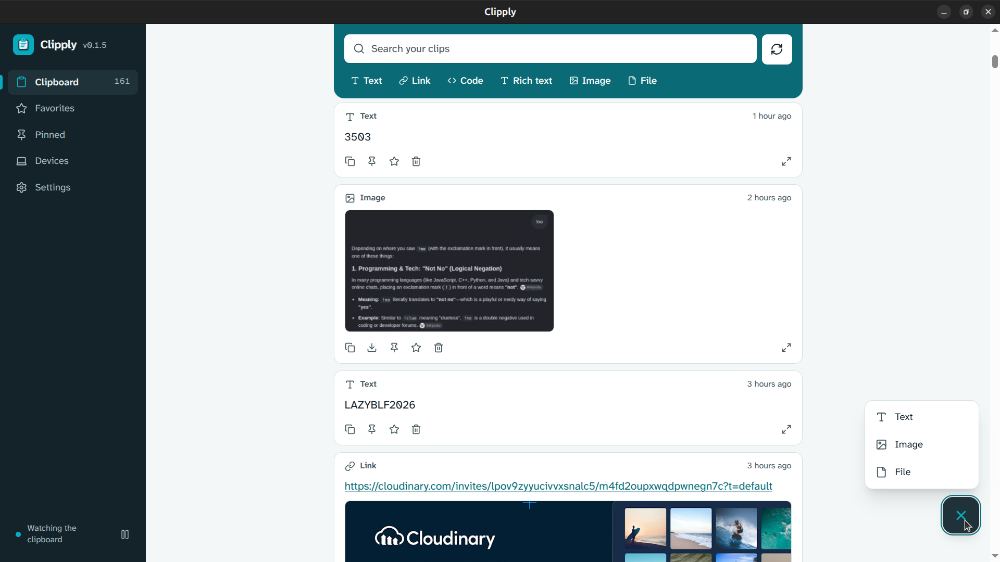 |  |
| Tray app, `Super+V` toggle, type filters, pin / favorite, devices and settings in the sidebar | Same shared UI; capture from app open, share sheet, text selection, Quick Settings tile and screenshots |

---

## Contents

- [Privacy in one minute](#privacy-in-one-minute)
- [What the server can and cannot see](#what-the-server-can-and-cannot-see)
- [Architecture at a glance](#architecture-at-a-glance)
- [Encryption, explained as a story](#encryption-explained-as-a-story)
- [Encryption and decryption](#encryption-and-decryption)
- [Don't take our word for it: real server data](#dont-take-our-word-for-it-real-server-data)
- [Adding devices, the recovery key, and removing devices](#adding-devices-the-recovery-key-and-removing-devices)
- [Protection on the device itself](#protection-on-the-device-itself)
- [Android permissions, explained](#android-permissions-explained)
- [Update channel and verifying downloads](#update-channel-and-verifying-downloads)
- [Installing](#installing)
- [Known limitations](#known-limitations)
- [Run your own server](#run-your-own-server)
- [Development](#development)
- [Further documentation](#further-documentation)

---

## Privacy in one minute

Installing an app from outside the Play Store means trusting the developer instead of Google's review. Clipply is built so that you need to trust the developer, and the services it runs on, as little as possible:

- **Encrypted on your device, decrypted only on your devices.** Content is encrypted with keys that are created on your device and are never sent to the server in readable form. The server, the database (MongoDB Atlas), the file storage (Cloudinary) and the host (Vercel) only ever receive ciphertext.
- **Google sign-in identifies your account and nothing more.** Your Google account is not used to derive or unlock any key. If someone took over the Clipply server or your Google login, they still could not decrypt your history.
- **New devices need your approval.** A device you add only gets your keys after you scan a QR code from one device with the other (or, between two computers, compare a 12-digit code on both screens). The server cannot add a device on its own.
- **No analytics, no ads, no crash reporting, no third-party SDKs that phone home.** The app talks to your Clipply API, Google (only for sign-in), Cloudinary (only to upload/download encrypted image and file blobs) and, on start and at most once a day after that, GitHub (to ask whether a newer version exists, and to download it when you tap Update — [details](#in-app-update-check)). Link previews, if you leave them on, fetch the linked page's preview image.
- **Works without an account.** Sync is optional. Without signing in, your history stays on the device, still encrypted at rest.
- **Open source.** Everything in this README can be checked in the code; file paths are given throughout.
- **Signed releases with checksums.** Every release ships a `SHA256SUMS` file, and the Android APK is always signed with the same key, so Android itself refuses any "update" signed by someone else ([details](#update-channel-and-verifying-downloads)).

If even that is not enough, you can [run your own server](#run-your-own-server): then nobody but you operates any part of the system.

---

## What the server can and cannot see

| Data | Server / MongoDB / Cloudinary | Notes |
|---|---|---|
| Clip content (text, links, code, rich text) | ❌ cannot read | Encrypted with a per-item key (XChaCha20-Poly1305) |
| Images, screenshots, files | ❌ cannot read | Encrypted on the device, uploaded to Cloudinary as an opaque private blob |
| Image thumbnails | ❌ cannot read | Made on the device, encrypted with the item's key |
| Clip type (text / link / image …), title, favorite, pinned, source device, timestamps you see in the app | ❌ cannot read | All inside the encrypted `meta` field. Filtering and search run locally |
| Your encryption keys, device private keys, recovery key | ❌ never sent | Only public keys and sealed (encrypted) keyrings reach the server |
| Exact content length | ❌ hidden | Ciphertext is padded to size buckets (256 B / 4 KiB / 64 KiB steps) |
| Your Google email address | ✅ visible | Needed to identify the account; shown on the Devices screen |
| Device names, platform, app version, last-seen / last-sync time | ✅ visible | Needed to show the device list before your vault is unlocked. You choose the names |
| Number of items, padded sizes, when you sync | ✅ visible | Unavoidable metadata of any sync service |
| Your IP address | ✅ visible | Seen by Vercel on every request. The API stores it only as part of a rate-limit counter on the sign-in endpoint, auto-deleted within ~2 minutes |

The server's job is reduced to **ordering, storing and authorizing**. It never decrypts anything. This is enforced by the design, not by a policy: the server simply never holds a key that could decrypt your data.

---

## Architecture at a glance

```text
 Ubuntu PC — Electron (apps/desktop)                Android phone — Capacitor + Kotlin (apps/mobile)
 ┌───────────────────────────────────────┐          ┌───────────────────────────────────────┐
 │ renderer: shared React UI (packages/ui)│          │ WebView: shared React UI (packages/ui) │
 │        ▲ IPC (fixed channels, Zod)     │          │  + sync-engine + crypto (TypeScript)   │
 │ main process:                          │          │  + SQLite (capacitor-sqlite)           │
 │  clipboard helper (XWayland) ─┐        │          ├───────────────────────────────────────┤
 │  screenshot watcher ──────────┤        │          │ Kotlin (runs without the WebView):     │
 │  sync-engine + crypto (TS) ◄──┘        │          │  share / tile / text-select / screenshot│
 │  SQLite (node:sqlite)                  │          │  → encrypt → Keystore inbox → WorkManager│
 │  keys: safeStorage → GNOME Keyring     │          │  keys: Android Keystore                │
 └──────────────────┬────────────────────┘          └──────────────────┬────────────────────┘
                    │        HTTPS · JSON · ciphertext only            │
                    └──────────────────────┬───────────────────────────┘
                                           ▼
                    ┌─────────────────────────────────────────────────┐
                    │ Clipply API — Express 5 on Vercel (apps/server)  │
                    │ stateless · auth · devices · vault · sync ·      │
                    │ storage signatures · daily cleanup cron          │
                    └──────────┬──────────────────────────┬───────────┘
                               ▼                          ▼
                    MongoDB Atlas                Cloudinary (private, raw)
                    encrypted items, sealed      encrypted image / file blobs,
                    keyrings, minimal metadata   uploaded/downloaded directly by devices
```

| Piece | Runs where | Holds keys? | Stores |
|---|---|---|---|
| Desktop app | Your PC (tray, always on) | ✅ in GNOME Keyring | Local SQLite with the same ciphertext the server has |
| Android app | Your phone (only while open; Kotlin capture on demand) | ✅ in Android Keystore | Local SQLite with ciphertext + encrypted capture inbox |
| API | Vercel serverless function | ❌ never | Nothing in memory; everything in MongoDB |
| MongoDB Atlas | Cloud | ❌ | Encrypted items, sealed keyrings, accounts, devices, sessions |
| Cloudinary | Cloud | ❌ | Encrypted blobs for images and files (> ~48 KB) |

Both apps run the **same TypeScript core** (`packages/sync-engine`, `crypto`, `database`, `ui`); each platform only supplies clipboard access, secure key storage and the UI shell. Sync is offline-first: local SQLite is the source of truth, changes go through an outbox, the server numbers every accepted change (`seq`) and devices pull "everything after N". Code-level walkthrough: [docs/code-overview.md](docs/code-overview.md).

---

## Encryption, explained as a story

The technical details follow in the next sections. This is the same design told with a house, keys and a post office, for anyone who wants the idea without the cryptography.

### The cast
- **Your house** is your account (you sign in with Google).
- **The people living there** are your devices: laptop, phone, and so on.
- **The post office** is the Clipply server. It delivers and stores packages between your devices. It is trusted to deliver, **never trusted to look inside**.
- **The warehouse** is Cloudinary, where big packages (images and files) are kept.

### 1. Every device has its own padlock
When Clipply is installed, each device makes a **padlock and its key** (a public and a private key).
- The **open padlock** (public key) is handed out freely; the post office keeps a copy.
- The **key to that padlock** (private key) **never leaves the device**. It lives in the device's own safe: the Android Keystore, or the GNOME Keyring on Linux.

Anyone can snap that padlock shut on a box, but only that device can open it again. Each device also has a **personal stamp** (a signing key), so others can tell a box really came from it.

### 2. The house key
The first device to sign in makes the **house key** (the vault key). This one key opens every clip. Next to it, the device keeps the **guest list** (the roster): which devices belong to the house, and their padlocks.

### 3. Every clip gets its own lockbox
When you copy something:
1. It goes into a **small lockbox** with its own unique key.
2. That small key is locked with the **house key** and taped to the outside.
3. **Packing peanuts** (padding) are added, so the size gives little away.
4. The box goes to the post office; big ones (images, files) go to the warehouse, and the post office keeps a note of where.

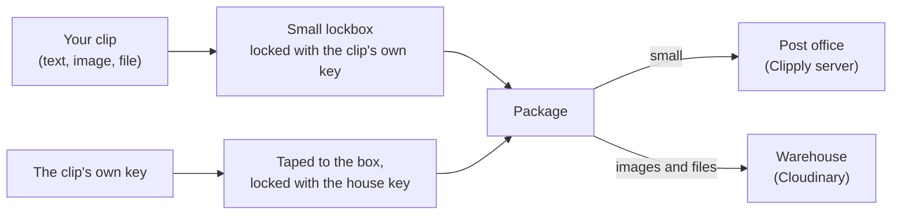

The post office ends up with many boxes, each with a locked key taped on. **Without the house key, every one of them is useless to it.**

### 4. A new phone joins the house
1. The phone makes its own padlock and key, and asks to join. It waits on the **waiting list** (`pending`). Your other devices notice and ask you: "Phone wants to join your account".
2. You prove the phone is really the one in your hand by **scanning a QR code**: either device can show it, the other scans it. The code carries a fingerprint of the showing device's padlock and a one-time secret that only travels through the camera, never through the post office. If the post office had secretly swapped in a padlock of its own, the fingerprint would not match. Two computers without cameras compare a **12-digit code** on both screens instead; it does the same job.
3. The existing device **copies the house key**, puts it in a box, **snaps the phone's padlock on it**, stamps it, and hands it to the post office.
4. The phone checks the stamp ("yes, from the device I just paired with") and opens the box with **its own key**.
5. Now the phone has the house key: it picks up every clip box and opens them at home.

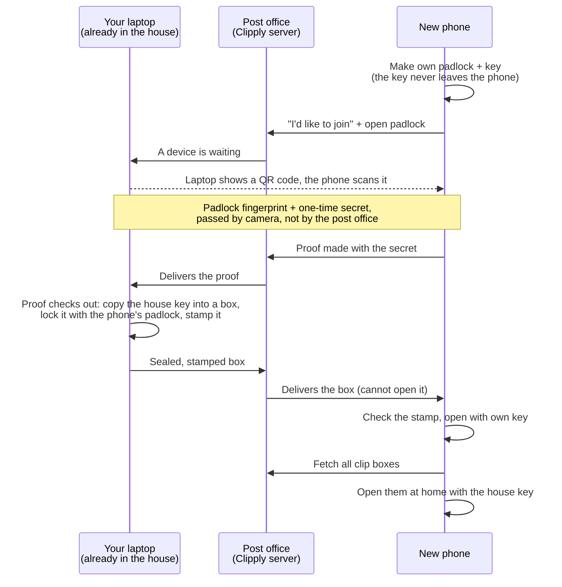

**Only one key ever travels: the house key, inside a box only the receiving device can open.** Private keys never move.

### 5. Everyday syncing
Each new clip is boxed (step 3) and handed to the post office. Every minute or so, each device asks "anything new for me?", picks up new boxes and opens them at home. The post office only ever passes along locked boxes.

Pictures are big, so a device fetches the newest few in the background (up to 5 among your last 15 clips), and older ones only when you open or copy them.

If a device was switched off while the guest list changed several times (say, a reinstalled phone joined and then removed its old self), the latest box may be stamped by a device it has never met. It then goes through the stamped boxes it missed, oldest first, and accepts each one only if a device it already trusts stamped it. That way it catches up on its own, with no new approval.

### 6. The spare key in a bank vault (recovery key)
When the house is set up, you get a **recovery key**, the long code you must save.
- The post office keeps one more copy of the house key, in a box locked with a padlock **only the recovery key opens**.
- Lost every device? A new device plus your recovery key opens that box and gets the house key back.
- Lose both your devices **and** your recovery key, and the house stays locked forever. Nobody can let you back in: not the post office, not the developer.

### 7. Someone moves out (removing a device)
A lost or old phone still holds a copy of the house key, so a remaining device:
1. **Changes the locks**: makes a new house key (the next "epoch": 2, 3, …).
2. Sends boxed copies of the new key **only to the devices still living there**.
3. Crosses the old phone off the guest list. If that phone had seen the recovery key, the recovery key is replaced too.

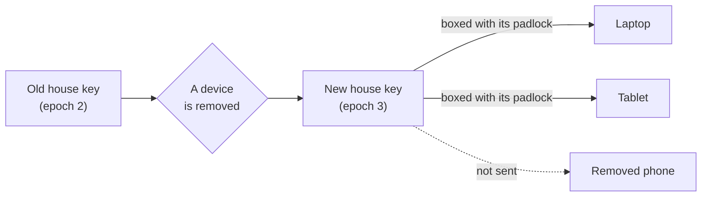

The removed phone can still open boxes it already had, but nothing locked after it left. Old house keys stay on the key ring, so older clips keep opening for everyone else.

### 8. Signing out
Signing out means **handing in your keys and emptying your room**: this device's copy of the house key and its history are deleted from this device only, and it gets a brand-new padlock so it can join a different house cleanly. The boxes at the post office are untouched; sign back in, get approved again, and they all open.

### 9. What the post office can and cannot see
| The post office sees | The post office never sees |
|---|---|
| Whose house a box belongs to | What is inside any box |
| How many boxes, roughly how big (padded), when they arrive | The house key |
| Device names and your email | Any device's private key or your recovery key |

Even someone who stole the entire post office (the database and the warehouse) would get a room full of locked boxes and no keys.

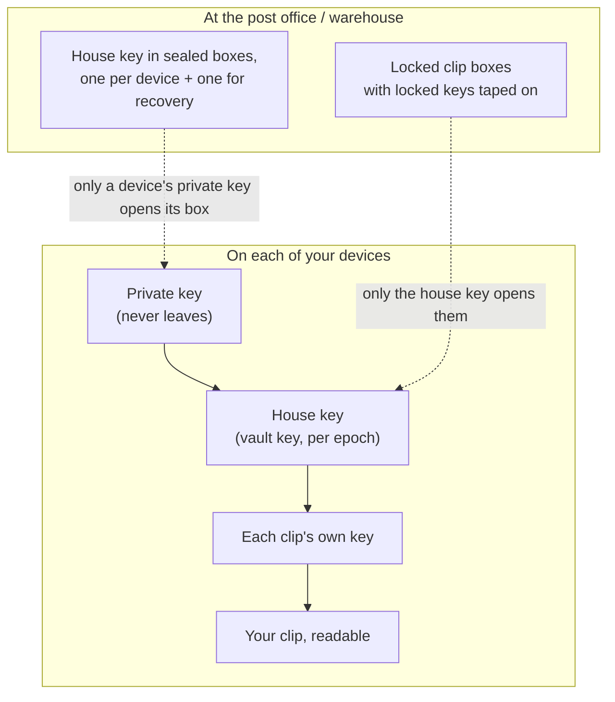

**The one idea to remember:** private keys never move. The house key moves only inside boxes that a single device can open, and scanning the QR code (or comparing the 12-digit code) makes sure each box goes to the right device.

## Encryption and decryption

All cryptography uses [libsodium](https://doc.libsodium.org/), a widely audited library. No custom ciphers. Implementation: [packages/crypto](packages/crypto/src); full specification: [docs/encryption.md](docs/encryption.md).

| Purpose | Primitive |
|---|---|
| Encrypting content and wrapping keys | XChaCha20-Poly1305 (256-bit key, random 192-bit nonce) — authenticated, any tampering is detected |
| Delivering the keyring to a device | X25519 sealed boxes (public-key encryption) |
| Signing keyrings and recovery proofs | Ed25519 |
| Deriving sub-keys | BLAKE2b KDF |
| Duplicate detection without revealing content | BLAKE2b keyed hash (key derived from your vault key, unknown to the server) |
| Hiding content length | ISO/IEC 7816-4 padding to size buckets |

### Key hierarchy

```text
Recovery key (256-bit, shown to you once, 55 characters)
  └─ derives a recovery key-pair: lets you restore access if you lose every device

Keyring  (lives only on your devices, inside OS secure storage)
  ├─ vault keys  { epoch 1: VK1, epoch 2: VK2, … }   random 256-bit, a new one after each device removal
  ├─ roster      the list of your authorized devices and their public keys
  └─ recovery    public keys of your recovery key

Per item: a fresh random 256-bit data key (DEK)
  ├─ dek    DEK encrypted with the current vault key
  ├─ meta   (type, title, flags, timestamps, source device)  encrypted with DEK
  ├─ body   (the content itself, inline or as a Cloudinary blob)  encrypted with DEK
  └─ thumb  (image preview)                                   encrypted with DEK

Per device: an X25519 + Ed25519 key-pair that never leaves the device's secure storage
```

Every ciphertext is bound to its item and field (`clipply/v1/<itemId>/<field>` as associated data), so the server cannot swap one item's content into another or replace a title with a body: decryption would fail.

### Encrypt (on the device that copies)

1. The app reads the clipboard **on your device** (on Android only when the app is focused, or when you share / use the tile — see [permissions](#android-permissions-explained)). Password-manager clips are skipped (Android `EXTRA_IS_SENSITIVE`, Linux `x-kde-passwordManagerHint`).
2. A keyed hash checks for duplicates locally.
3. A new random DEK encrypts `meta`, `body` and (for images) a thumbnail made on the device. The DEK itself is encrypted with the current vault key.
4. The ciphertext is saved in local SQLite and queued in the outbox — in one transaction.
5. If sync is on, the outbox pushes the ciphertext to the API. Large bodies (images, files) are uploaded **directly to Cloudinary** with a signature the API issues; the API never sees those bytes.

### Decrypt (on any of your devices)

1. The device pulls new changes (`GET /v1/sync/pull?cursor=N`) and stores the ciphertext as-is.
2. It unwraps the DEK with the vault key of the item's `keyEpoch`, then decrypts `meta` and text bodies into an **in-memory** index for list and search.
3. Images and files are fetched only when you open them: the API returns a 10-minute signed Cloudinary URL, the device downloads ciphertext, decrypts in memory and shows it via a `blob:` URL / content provider. Plaintext is never written to disk.

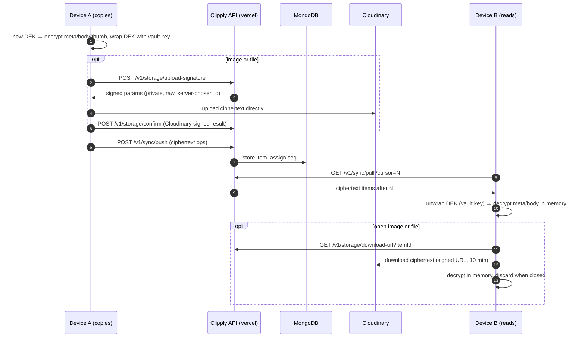

### How the keys get to a new device

The vault key is never sent in readable form. An authorized device seals the keyring to the new device's X25519 public key and signs it with its Ed25519 key; that sealed **envelope** is the only thing the server relays. The new device opens it only if the signer is the device it paired with: the one whose QR code it scanned or that scanned its QR code, or whose 12-digit code you confirmed ([details](#adding-devices-the-recovery-key-and-removing-devices)).

---

## Don't take our word for it: real server data

These are screenshots of the production MongoDB Atlas database and Cloudinary account, showing the developer's own synced history. This is what the operator sees. Every collection is shown.

### MongoDB: `clipboard_items`

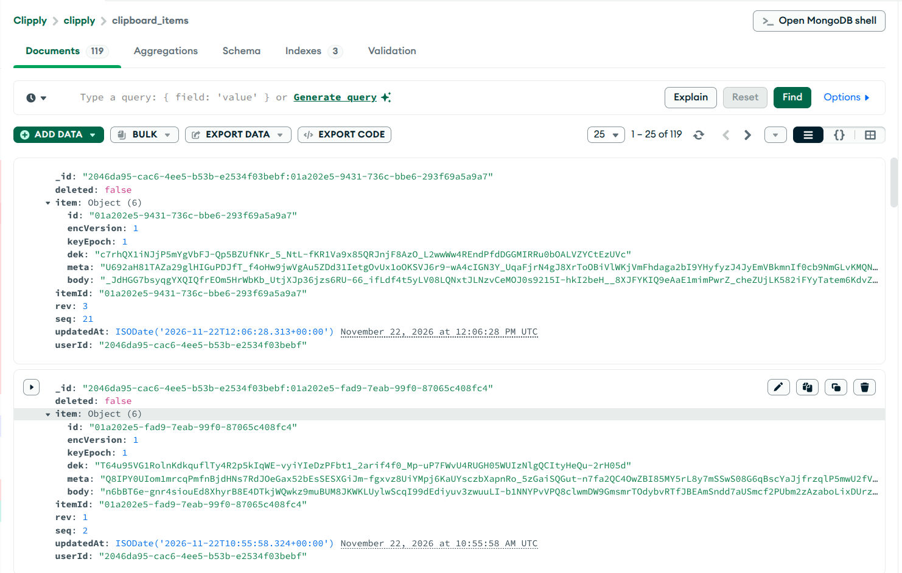

Each document is one clip. `dek`, `meta` and `body` are XChaCha20-Poly1305 ciphertext (base64url). There is no `text`, `type`, `title`, `favorite` or `pinned` field: all of that is inside `meta`, encrypted. The only readable fields are random ids, the key epoch, revision/sequence counters, a `deleted` flag and the server's own timestamp.

### MongoDB: `device_key_envelopes`

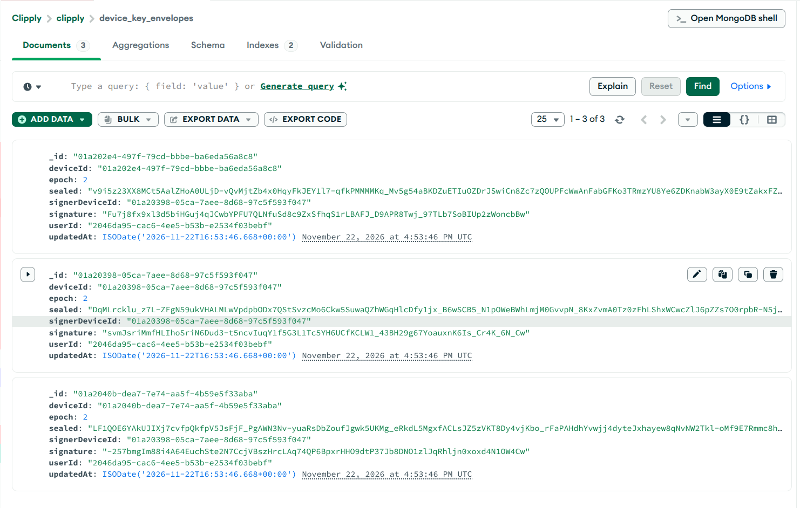

How your keyring travels between devices. `sealed` is the keyring encrypted to one device's public key (X25519 sealed box), so only that device can open it; `signature` is an Ed25519 signature by the device that published it (`signerDeviceId`). `epoch: 2` shows a key rotation happened after a device was removed. A companion collection, `device_key_envelope_history`, keeps the earlier envelopes of each device (365 days, deleted when the device is removed), so a device that missed several device-list changes can replay them and check every signer.

### MongoDB: `users`


One document per account: Google account id (`googleSub`), email, the change counter `seq`, the current `keyEpoch`, and `vault.recovery` — your recovery **public** keys plus a copy of the keyring **sealed** to them, which only your recovery key can open.

### MongoDB: `devices`


Name, platform, app version, status (`pending` / `authorized` / `revoked`), the device's **public** keys and timestamps. This is the metadata the Devices screen shows before your vault is unlocked. Private keys never appear here. A removed device stays as a `revoked` record with `revokedAt` for 30 days, so its id cannot sign in again, and is then deleted.

### MongoDB: `encrypted_objects`

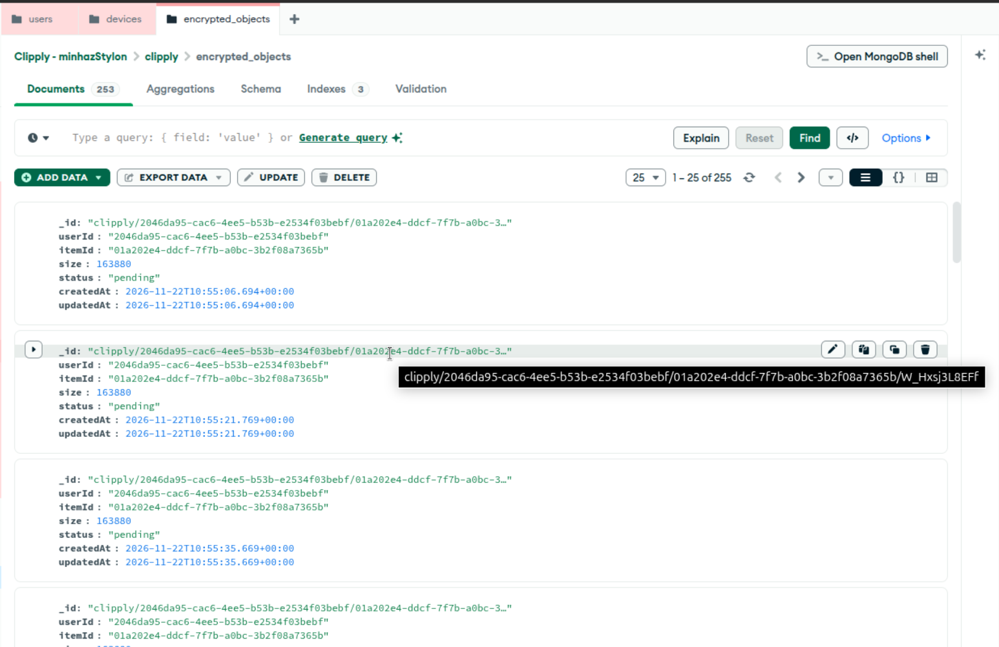

Which Cloudinary blob belongs to which item, its padded size and its lifecycle (`pending` → `uploaded` → `attached` → `delete_pending`). Used for ownership checks, quota and cleanup. No content, no file names. The records shown are `pending`: upload slots handed out for one image whose first attempts were never confirmed.

### MongoDB: `sessions`

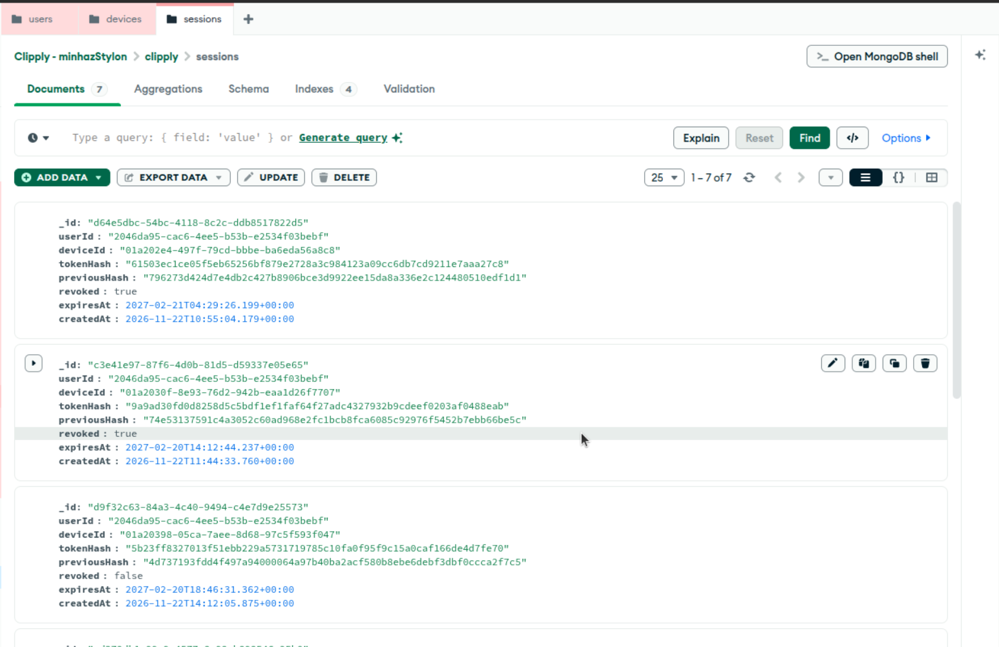

Refresh tokens are stored only as SHA-256 hashes (`tokenHash`). `previousHash` detects replay of a rotated token: presenting it again revokes the session.

### MongoDB: `sync_events`

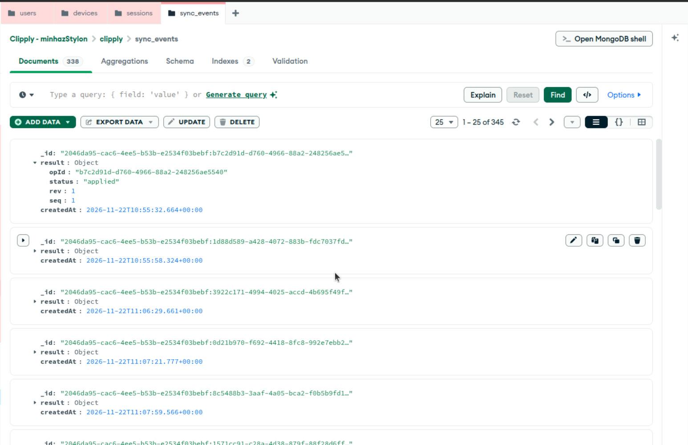

The result of each pushed change, keyed by its `opId`, so a retried push gets the same answer instead of applying twice. Auto-deleted after 7 days. (`rate_limits` — short-lived request counters, auto-deleted within minutes — is the remaining collection.)

### Cloudinary: images and files

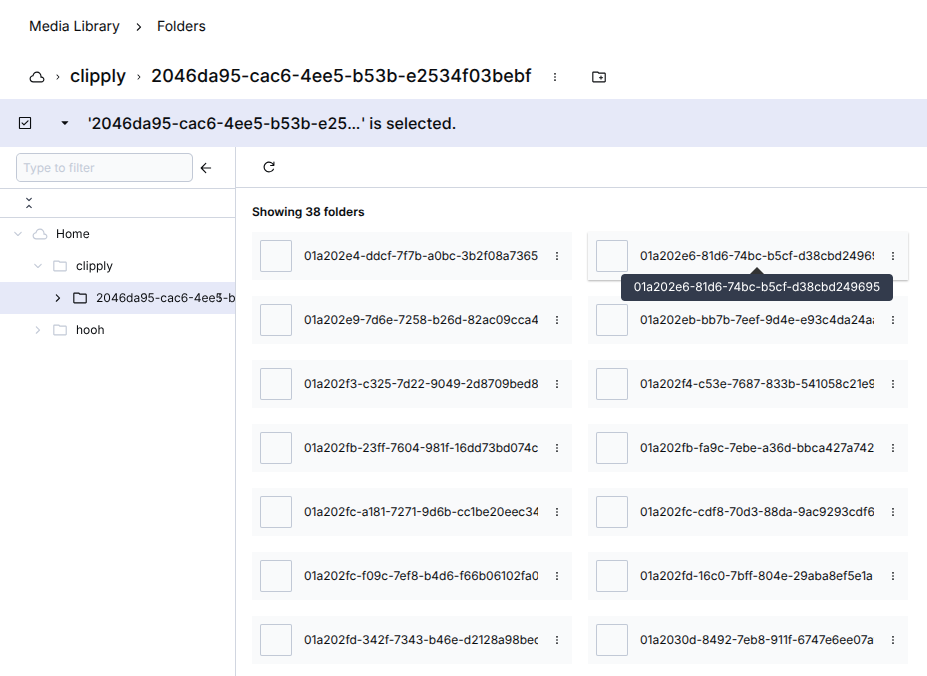

Blobs are stored under `clipply/<userId>/<itemId>/`. Cloudinary shows **no thumbnails**: it has nothing it can decode.


Opening one of them (a 160 KB image clip): **"No preview available"**, **Format: N/A**, **Delivery type: Private**. To Cloudinary it is 160 KB of random bytes. Downloading it requires a signed URL that only the Clipply API issues, only to the owner, valid for 10 minutes — and even then you get the same ciphertext, useless without the keys on your devices. ("Access control: Public" in that panel is a separate Cloudinary setting; the *private* delivery type is what blocks unsigned downloads.)

A full dump of the database and Cloudinary gives an attacker email addresses, device names and encrypted blobs — not one byte of clipboard content. You can reproduce this by [running your own server](#run-your-own-server) and looking at your own database.

---

## Adding devices, the recovery key, and removing devices

### First device

When you first sign in, your device creates the vault: the keyring, your device key-pair and a **recovery key** (55 characters, shown once). Write it down or store it in a password manager. Clipply cannot show it to you again and cannot reset it for you.

### Adding another device

1. Sign in on the new device with the same Google account. It is **pending**: the server refuses it any access to your items. Your connected devices show "*Device* wants to join your account" (a banner on every screen, plus a system notification on the desktop).
2. Pair the two by **QR code**. Either device can show it, and an Android phone scans it:
   - new computer, connected phone: the computer's setup screen shows a QR code; on the phone open **Devices → Scan its QR code**;
   - new phone, connected computer: on the computer open **Devices → Show this device's QR code**; on the phone tap **Scan the other device's code instead**.

   The code carries a fingerprint of the showing device's public keys and a one-time secret (valid 10 minutes). The scanner checks the keys the server reports against the fingerprint, then answers with a proof made from the secret. The secret never passes through the server, so the server cannot fake the proof or swap in its own keys.
3. No camera (two computers)? On the connected device tap **Approve** next to the waiting one. Both show a 12-digit code computed from both devices' public keys. **Compare them**: if the server substituted a key, the codes will not match.
4. The connected device encrypts the keyring to the new device's verified public key, signs it and uploads that envelope. The new device accepts it only if it is signed by the device it paired with.

### Lost all your devices?

Use the recovery key on a new device. It proves possession of the recovery key with a signature (the key itself is never sent), then opens the copy of your keyring sealed to the recovery key. If you lose **every device and the recovery key**, your history cannot be decrypted by anyone, including the developer. That is the price of real end-to-end encryption.

### Removing a device

Removing a device takes effect immediately on the server (its sessions are revoked and its keyring copy deleted, it gets "forbidden" on every request). Your remaining device also **rotates the vault key**: everything saved afterwards uses a new key the removed device never had. If the removed device ever held the recovery key, a new recovery key is generated and shown to you. You can also replace a lost or exposed recovery key at any time from an authorized device.

---

## Protection on the device itself

| | Android | Ubuntu |
|---|---|---|
| Where keys live | AES-256-GCM key inside the **Android Keystore** (non-exportable) wraps the keyring, device keys and session | Electron `safeStorage` → **GNOME Keyring / libsecret**. If no keyring is available, Clipply refuses to store keys rather than storing them in clear |
| Local database | Same ciphertext as the server; no plaintext index on disk | Same; file created with `0600` permissions |
| Backups | `allowBackup="false"`, cloud backup and device transfer excluded — your keys never land in a Google backup | — |
| Things captured while the app is closed | Encrypted immediately with a Keystore key into a private inbox | Capture runs in the background tray app |
| Images | Shown from memory; copying an image to the clipboard is served from memory through a content provider — no plaintext file is written | Shown via in-memory `blob:` URLs |
| Logs | Plugin bridge logging disabled; app logs redacted | Redacted logs in `~/.config/Clipply/logs/main.log` (`0600`, rotated at 2 MB) |
| Password-manager clips | Skipped | Skipped |

Search works by decrypting your history into memory after unlock; nothing decrypted is ever written to disk.

---

## Android permissions, explained

Clipply asks for very little. From [AndroidManifest.xml](apps/mobile/android/app/src/main/AndroidManifest.xml):

| Permission | Why |
|---|---|
| `INTERNET` | Sync with your Clipply API, Google sign-in, encrypted blob upload/download |
| `READ_MEDIA_IMAGES` (Android 13+) / `READ_EXTERNAL_STORAGE` (Android ≤ 12) | **Only** requested if you turn on "Import new screenshots". Only files in the `Screenshots` folder created after you enable it are imported |
| `REQUEST_INSTALL_PACKAGES` | Only to open Android's installer for Clipply's own release APK when you tap **Update** ([details](#in-app-update-check)) |

Scanning a pairing QR code needs **no camera permission**: Google's code scanner runs in Google Play services' own screen and hands Clipply only the decoded text, never camera frames.

That is all. No contacts, location, microphone, camera, phone, SMS, accessibility service, notification listener, or "display over other apps".

How capture works without background clipboard spying (Android 10+ forbids it, and Clipply does not try to bypass it):

- **Open the app** → the current clipboard is read once (you can turn this off).
- **Share** text, images or files to Clipply from any app.
- **Select text → "Save to Clipply"** in the selection menu.
- **Quick Settings tile** "Save clipboard".
- **Screenshots** (opt-in) → Android wakes Clipply only when a new image appears.

No foreground service, no polling, no wake locks, no always-open connection. Measured on the emulator: 0 alarms, 0 wake locks and no network for the app while idle in the background.

---

## Update channel and verifying downloads

**GitHub Releases is the only official distribution channel:** <https://github.com/Sharif-Minhaz/clipply/releases>. There is no Play Store listing, no mirror, no third-party APK site. A Clipply download from anywhere else is not from this project.

Each release contains:

| File | Purpose |
|---|---|
| `Clipply-<version>.apk` | Android app, signed with the release key |
| `clipply_<version>_amd64.deb` | Ubuntu / Debian package |
| `Clipply-<version>-x86_64.AppImage` | Portable Linux app |
| `latest-linux.yml` | Update metadata for the desktop app |
| `SHA256SUMS` | SHA-256 checksum of every file above |

Releases are built by [scripts/release.mjs](scripts/release.mjs), normally on GitHub Actions ([release workflow](.github/workflows/release.yml), see [docs/release.md](docs/release.md)): versions are bumped (Android `versionCode` always increases, so Android refuses a downgrade), the build refuses to produce an unsigned APK or one pointing at a development server, and files go to a **draft** release that is published only after `SHA256SUMS` is written.

### Check the checksum

```sh
# in the folder with the downloaded files
sha256sum -c SHA256SUMS --ignore-missing
```

### Check where it was built

Releases built on GitHub Actions carry a signed attestation that links each file to the exact commit and workflow run that built it, so the download provably comes from this repository's public source:

```sh
gh attestation verify Clipply-<version>.apk --repo Sharif-Minhaz/clipply
```

A release built on the maintainer's machine (the fallback path) has no attestation; rely on the checksum and signing certificate for those.

### Check the APK signing certificate

Every Clipply APK is signed with the same certificate:

```text
SHA-256: a8:5d:b1:c3:d5:10:77:d2:0c:3c:c7:75:b2:a1:94:2d:87:de:f0:fa:1a:d3:97:9e:92:8c:8f:87:e9:ba:12:93
```

```sh
apksigner verify --print-certs Clipply-<version>.apk
# Signer #1 certificate SHA-256 digest: a85db1c3d51077d20c3cc775b2a1942d87def0fa1ad3979e928c8f87e9ba1293
```

**Why this matters for updates:** Android only installs an update over an existing app if it is signed with the **same key**. Once you have a genuine Clipply installed, a tampered APK from someone else cannot replace it — Android shows "App not installed" instead.

### In-app update check

Both apps can tell you when a new version is out: **Settings → Updates** shows your version and a **Check for updates** button. When a newer release exists, the desktop sidebar shows "Update available" and the Android Clipboard tab shows a banner. Tapping it updates the app; nothing is downloaded until you tap:

- **AppImage:** downloads the new AppImage (only the changed blocks when possible), checks its SHA-512 against the release's `latest-linux.yml`, replaces the old file and restarts. Autostart and the GNOME shortcut follow the new file name.
- **deb:** downloads the new `.deb`, checks its SHA-512, installs it with `dpkg` (the system asks for your admin password) and restarts.
- **Android:** downloads `Clipply-<version>.apk` from the release and opens Android's installer; you confirm with **Update**. The first time, Android asks you to allow installs from Clipply. Android only accepts an APK signed with the same key as the installed app.

If an update fails, Settings → Updates offers the release page so you can install by hand.

What it does, and what it does not do:

- **One anonymous request** to GitHub: `GET https://github.com/Sharif-Minhaz/clipply/releases/latest`, reading only the version from where it redirects (the REST API is avoided because its anonymous limit of 60 requests an hour is shared by everyone on the same network). No account, device id, token or anything about your clips is sent.
- **Every time the app starts**, then at most once a day when it comes back to the foreground (Android) or its window gets focus (desktop). A newer version shows a banner at the top of the clip list. Nothing is polled in the background. Pressing "Check for updates" always checks.
- **Nothing installs by itself.** An update is downloaded and installed only after you tap it.
- **The link cannot be redirected.** The app reads only the version number and builds the link to `github.com/Sharif-Minhaz/clipply/releases/tag/v<version>` itself; drafts and pre-releases are ignored.
- **You can turn it off:** Settings → Updates → "Check for updates automatically". The manual button keeps working.

Implementation: [packages/sync-engine/src/update.ts](packages/sync-engine/src/update.ts) (check), [apps/desktop/electron/main/updater.ts](apps/desktop/electron/main/updater.ts) (desktop install), `installUpdate` in [ClipplyNativePlugin.kt](apps/mobile/android/app/src/main/java/co/lazycoders/clipply/ClipplyNativePlugin.kt) (Android install).

---

## Installing

### Android

1. Download `Clipply-<version>.apk` from [Releases](https://github.com/Sharif-Minhaz/clipply/releases/latest) and optionally [verify it](#update-channel-and-verifying-downloads).
2. Open it. Android asks once to allow installs from your browser / file manager ("Install unknown apps"). You can switch that off again after installing.
3. If Play Protect shows "unknown developer", this is because the app is not on the Play Store, not because something was detected. Choose "Install anyway".
4. Open Clipply. Use it locally, or sign in with Google to sync. On your first device, **save the recovery key**.
5. Optional: add the "Save clipboard" tile to Quick Settings.

### Ubuntu

```sh
sudo apt install ./clipply_<version>_amd64.deb
# or
chmod +x Clipply-<version>-x86_64.AppImage && ./Clipply-<version>-x86_64.AppImage
```

The app keeps running in the tray when you close the window. On GNOME Wayland, press "Add shortcut" in Settings to register `Super+V` as a GNOME custom shortcut that shows/hides Clipply (GNOME's notification list moves to `Super+M`). Tested on Ubuntu 24.04 / GNOME 46.

To add the phone as a second device: sign in on it with the same Google account, open **Devices → Show this device's QR code** on the computer, and scan it from the phone.

---

## Known limitations

- **A compromised, unlocked device** (malware running as you) can read what you can read. No app can prevent that.
- **Metadata** listed in [the table above](#what-the-server-can-and-cannot-see) — email, device names, item counts, padded sizes, timing, IP addresses — is visible to the server and its hosting providers.
- **The server can withhold or replay** an older version of an item. It cannot read or forge content, but it can refuse to deliver changes.
- **A device you removed, colluding with the server,** could briefly target a device that has not synced since the removal. Devices refresh on every sync, so the window is small.
- **A pairing QR code seen by someone else** (a photo, a shared screen) while it is shown is as sensitive as the 12-digit code: together with control of the server or your Google account, it could let them pair their own device. It expires after 10 minutes and is used up by the first pairing.
- **Backups** (export/import) are protected by your passphrase with PBKDF2 (600 000 iterations). A weak passphrase is the weak point; use 4+ random words.
- Android keeps keys in WebView memory while the app is open; new items from other devices appear when you open the app (no push notifications, by design).
- Android background capture uploads **text** immediately; images captured while the app is closed upload the next time you open it.
- Linux on GNOME Wayland: copies from native Wayland apps cannot be attributed to an app, so the "excluded apps" setting only works for X11/XWayland windows.
- Updates install only when you tap them, and the deb update needs your admin password. On Android you confirm each update in the system installer.

Full threat model, with which protections are covered by automated tests: [docs/encryption.md §8](docs/encryption.md#8-threat-model).

---

## Run your own server

The official apps point at the project's API. For maximum control you can deploy your own on free tiers (no credit card): Vercel Hobby, MongoDB Atlas M0, Cloudinary Free and a Google OAuth client. Then build the apps with your API URL. Step-by-step: [docs/deployment.md](docs/deployment.md). Your own server still only ever sees ciphertext.

---

## Development

### Layout

```text
apps/
  desktop/   Electron 45 + React 19: clipboard capture, tray, shortcuts, safeStorage
  mobile/    Capacitor 8 + React 19 + Kotlin: capture entry points, Keystore, WorkManager
  server/    Express 5 on Vercel: auth, devices, vault, sync, storage, daily cleanup
packages/
  shared-schemas  Zod schemas for every wire format (single source of truth)
  crypto          libsodium: item encryption, keyring, envelopes, recovery, backups
  sync-engine     capture → dedupe → encrypt → store → push/pull, vault protocol
  database        SQLite migrations and repositories
  api-client      typed HTTP client
  ui              shared React UI for both apps
  logger          logger with recursive redaction of content and secrets
docs/             code overview · architecture · encryption · synchronization · backend · desktop · android · deployment
scripts/          release pipeline
```

How the three apps are wired, file by file: **[docs/code-overview.md](docs/code-overview.md)**.

### Setup

Requires Node ≥ 24 (npm workspaces). Android builds need JDK 21+ and the Android SDK.

```sh
npm install
npm run gate               # typecheck + tests in every package
```

Each app reads its configuration from a `.env` file; copy the `.env.example` next to it: [apps/server](apps/server/.env.example), [apps/desktop](apps/desktop/.env.example), [apps/mobile](apps/mobile/.env.example).

### Build and run (from the repo root)

| Script | What it does |
|---|---|
| `npm run desktop:dev` | Desktop app with hot reload |
| `npm run desktop:dist` | AppImage + deb in `apps/desktop/dist/` |
| `npm run server:dev` / `server:build` | Local API / Vercel bundle |
| `npm run android:debug` | Debug APK |
| `npm run android:install:usb` / `android:install:wifi` | Install the debug APK on a phone |
| `npm run android:live` / `android:live:wifi` | Run on the phone with live reload (served as `http://localhost` via `adb reverse`, so WebCrypto works) |
| `npm run android:logs` | WebView console, Kotlin plugin/worker logs, WorkManager, crashes |
| `npm run android:release` | Release APK, signed when `apps/mobile/android/keystore.properties` exists |
| `npm run icons:android -w @clipply/mobile` | Regenerate launcher icons from `apps/mobile/assets/` |

### Releasing

| Script | What it does |
|---|---|
| `npm run publish [-- patch\|minor\|major\|x.y.z]` | Everything below, in order (default `patch`) |
| `npm run release:bump` | Bump desktop, mobile and Android `versionCode`/`versionName` |
| `npm run release:build` / `:linux` / `:android` | Build and stage artifacts in `release/v<version>/` |
| `npm run release:tag` | Commit the version files and create tag `v<version>` |
| `npm run release:push` | Push the branch and the tag |
| `npm run release:upload` | Create/complete the GitHub release, write `SHA256SUMS`, publish |

Each step after `bump` can be re-run on its own if one fails. The GitHub token comes from `GH_TOKEN` / `GITHUB_TOKEN` or `.env.release` (gitignored; needs "Contents: read & write"). Build steps run without the token, so electron-builder can never publish by itself.

Release signing — create once, keep both files out of git (already ignored) and backed up:

```sh
keytool -genkeypair -v -keystore apps/mobile/android/clipply-release.jks -alias clipply -keyalg RSA -keysize 4096 -validity 10000
cat > apps/mobile/android/keystore.properties <<'P'
storeFile=clipply-release.jks
storePassword=…
keyAlias=clipply
keyPassword=…
P
```

Losing the keystore means users must uninstall to update, and the published certificate fingerprint above would change. Register the release key's SHA-1 (`keytool -list -v -keystore …`) as an Android OAuth client too.

---

## Further documentation

- [Code overview](docs/code-overview.md) — how desktop, mobile and server are wired; shared patterns
- [Architecture](docs/architecture.md) — decisions, data model, risks
- [Encryption](docs/encryption.md) — key hierarchy, ciphertext format, enrollment, recovery, rotation, threat model
- [Synchronization](docs/synchronization.md) — ordering, conflicts, loop prevention
- [Backend](docs/backend.md) — API, collections, limits, maintenance
- [Deployment](docs/deployment.md) — MongoDB Atlas, Cloudinary, Google OAuth, Vercel
- [Desktop](docs/desktop.md) — GNOME Wayland/X11 clipboard, screenshots, tray, shortcuts
- [Android](docs/android.md) — clipboard limits, capture entry points, battery rules
- [Roadmap](docs/development-roadmap.md)
